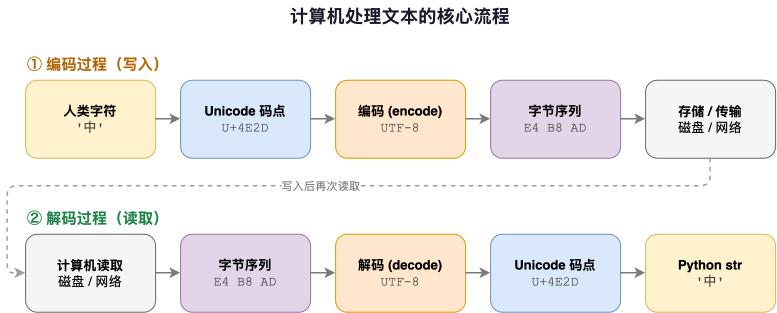
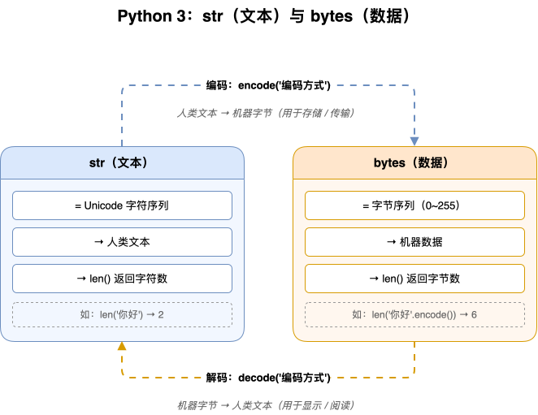
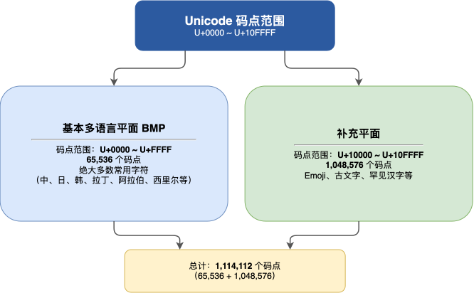
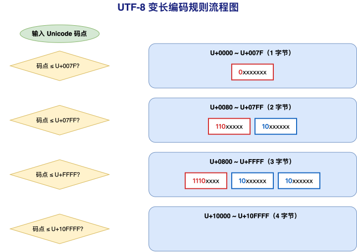

---
group:
  title: 【03】字符串介绍
  order: 3
order: 10
title: encode 与 decode 方法
nav:
  title: Python基础
  order: 1
---

# encode 与 decode 方法

## 1. 介绍

### 1.1 知识点定义

在 Python 中，`str` 是给人看的文本，`bytes` 是给机器传输/存储的字节序列。`encode()` 与 `decode()` 就是这两个类型之间唯一的官方转换通道：

- **`str.encode()`**：把字符串编码成字节序列，方向是 `str → bytes`
- **`bytes.decode()`**：把字节序列解码成字符串，方向是 `bytes → str`

方法签名：

```text
str.encode(encoding='utf-8', errors='strict') -> bytes
bytes.decode(encoding='utf-8', errors='strict') -> str
```

参数说明：

- **encoding**：编码方案的名字，如 `'utf-8'`、`'gbk'`、`'ascii'`、`'latin-1'`。两个方法的默认值都是 `'utf-8'`，不传就走默认
- **errors**：编解码遇到"编不了/解不了"的字符时怎么办，默认 `'strict'`（直接抛异常）

这两个参数对两个方法含义相同，但同一个编码名在 encode 与 decode 两侧的行为可能完全不同——这正是乱码问题的根源。

一个字符从"眼见"到"存储"要经过三层：

```text
"中" 的三层视图

  字符层（人类看到）       码点层（统一的编号）          字节层（存储与传输）
  ─────────────────       ─────────────────────        ─────────────────────
        "中"      ─字符集─▶   U+4E2D（十进制 20013）  ─编码方案─▶   E4 B8 AD
                              │           ▲                        │
                              │ ord()取号  │ chr()还原               │ len()/list() 数字节
                              ▼           │                        ▼
                              同一个号码支撑两个方向的查询          utf-8 下 '中' 占 3 个字节

  ── ASCII：只编号前 128 个字符，编号即字节
  ── Unicode/GBK/latin-1：字符集与编码方案的组合各不相同
```

对应到方法上：

```text
            encode('utf-8')                        decode('utf-8')
   "中"(str) ────────────────▶ b'\xe4\xb8\xad'(bytes) ────────────────▶ "中"(str)
    文本对象                      字节序列                         文本对象
                                 在网络/文件里流动
```



### 1.2 最简示例

先用几行代码直观感受"编码—解码"一个来回：

```python
text = "Python中文"

# encode：str → bytes（默认 utf-8）
encoded = text.encode()
print(encoded)

# decode：bytes → str（默认 utf-8）
decoded = encoded.decode()
print(decoded)

# 走一个来回，内容不丢
print(text == decoded)
```

**运行结果**：

```text
b'Python\xe4\xb8\xad\xe6\x96\x87'
Python中文
True
```

可以看到三个事实：

- 字符串编码后变成 `b'...'` 开头的 **bytes 对象**，中文在显示时以 `\xe4\xb8\xad` 这样的十六进制转义呈现
- 解码后又变回了普通字符串，可以直接打印
- 同一编码进、同一编码出，内容必然还原

### 1.3 encode 与 decode 的核心特点

- **方向固定**：`encode` 只属于 `str`，`decode` 只属于 `bytes`。对象搞反了会直接报 `AttributeError`
- **默认编码是 utf-8**：不传 `encoding` 时，两个方法都按 utf-8 处理，且这个默认值**与操作系统无关**
- **类型严格隔离**：`str` 与 `bytes` 不能混用——不能拼接、不能比较相等、不能互相放进对方的方法里
- **错误行为可控**：遇到编不了的字符/解不了的字节，默认抛异常，但可以通过 `errors` 参数换成丢弃、替换、转义等策略
- **大概率可逆**：只要"编码—解码用的是同一种编码方案且不丢信息"，往返必相等；一旦两侧编码不一致或用了丢信息的错误策略，出问题就毫无征兆

## 2. 核心内容

### 2.1 先认识 bytes：decode 的操作对象

`decode()` 的操作对象是 `bytes`。在学解码之前，先把 `bytes` 这个类型看清楚——它是"一串 0~255 的整数"，仅此而已。

#### 2.1.1 bytes 的四种创建方式

```python
# 方式1: 字节字面量，b 前缀 + 只含 ASCII 字符
b1 = b'Hello'
print(b1, type(b1))

# 方式2: 字节字面量 + 十六进制转义（\xNN 表示一个字节）
b2 = b'\xe4\xb8\xad'          # 恰好是 '中' 的 utf-8 编码
print(b2)

# 方式3: bytes() 从整数列表构造，每个元素 0~255
b3 = bytes([0x48, 0x69])      # 0x48='H' 0x69='i'
print(b3)

# 方式4: 字符串 encode 得到（最常用、最推荐）
b4 = '中文'.encode('utf-8')
print(b4)
print(len(b4), list(b4))
```

**运行结果**：

```text
b'Hello' <class 'bytes'>
b'\xe4\xb8\xad'
b'Hi'
b'\xe4\xb8\xad\xe6\x96\x87'
6 [228, 184, 173, 230, 150, 135]
```

关键认知：`'中文'` 编码成 utf-8 后占 **6 个字节**（每个汉字 3 字节），`list()` 把每个字节按整数展开——`228` 就是十六进制的 `0xE4`。

#### 2.1.2 怎么读 bytes 的显示形式

`bytes` 打印出来的样子容易吓到初学者，规则其实很简单：

```python
b = 'Hello中文'.encode('utf-8')
print(b)
print(b.hex())

# 遍历 bytes 得到的是整数；能按 ASCII 显示的字节直接显示字符，
# 其余字节在打印 bytes 时用 \xNN 转义
for byte in b:
    print(byte, hex(byte), chr(byte) if 32 <= byte < 127 else '(不可打印)')
```

**运行结果**：

```text
b'Hello\xe4\xb8\xad\xe6\x96\x87'
48656c6c6fe4b8ade69687
72 0x48 H
101 0x65 e
108 0x6c l
108 0x6c l
111 0x6f o
228 0xe4 (不可打印)
184 0xb8 (不可打印)
173 0xad (不可打印)
230 0xe6 (不可打印)
150 0x96 (不可打印)
135 0x87 (不可打印)
```

三条读法规则：

- `print(bytes)` 时，能按 ASCII 显示的字节直接显示为字符（`H`、`e`、`o`），不能显示的字节用 `\xNN` 十六进制转义（`\xe4`）
- `b.hex()` 把每个字节都按两位十六进制串起来，看"原始字节值"最方便：`48 65 6c 6c 6f e4 b8 ad e6 96 87`
- 遍历 bytes 得到的是 **int**（72、228...），不是单字符——这是 bytes 与 str 最大的行为差异



#### 2.1.3 bytes 的索引、切片与长度：与 str 逐一对照

`str` 按字符操作，`bytes` 按字节操作，两边的行为完全平行：

```python
s = 'AB中'
data = s.encode('utf-8')            # b'AB\xe4\xb8\xad'
print("len('AB中') =", len(s), "          # str 按字符数")
print("len(bytes)  =", len(data), "          # bytes 按字节数")
print("s[0]   =", repr(s[0]), "         # str 索引 → 字符")
print("data[0] =", repr(data[0]), "     # bytes 索引 → 整数")
print("s[2:]   =", repr(s[2:]), "         # str 切片 → str")
print("data[2:] =", repr(data[2:]), "   # bytes 切片 → bytes")
```

**运行结果**：

```text
len('AB中') = 3           # str 按字符数
len(bytes)  = 5           # bytes 按字节数
s[0]   = 'A'          # str 索引 → 字符
data[0] = 65      # bytes 索引 → 整数
s[2:]   = '中'          # str 切片 → str
data[2:] = b'\xe4\xb8\xad'    # bytes 切片 → bytes
```

| 维度 | `str` | `bytes` |
|------|-------|---------|
| `len()` | 字符（码点）个数 | 字节个数 |
| 索引 `[0]` | 得到 1 个字符（str） | 得到 1 个整数（int，0~255） |
| 切片 `[2:]` | 得到 str | 得到 bytes |
| 遍历 | 逐字符 | 逐字节（int） |
| 可拼接对象 | 只能拼 str | 只能拼 bytes |

`'AB中'` 长度是 3 个字符，但编码后变成 5 个字节（`A`、`B` 各 1 字节，`中` 占 3 字节）——这就是"字符数"和"字节数"的差别，也是编码转换必须面对的第一课。

#### 2.1.4 str 与 bytes 为什么不能混用

两个类型互不认识，任何混用都是 TypeError 或者"看起来成功但结果是假"：

```python
data = 'Hello中文'.encode('utf-8')

# 拼接：两个方向都会炸
try:
    _ = data + '!'
except TypeError as e:
    print("bytes + str ->", e)
try:
    _ = 'he' + data
except TypeError as e:
    print("str + bytes ->", e)

# 相等比较：不报错，但永远 False
print("data == 'Hello中文' ->", data == 'Hello中文')

# 查找：str 不能直接放进 bytes 里找
try:
    _ = '中' in data
except TypeError as e:
    print("'中' in bytes ->", e)

# 正确姿势：先按同样的编码转成 bytes 再查
print("'中'.encode('utf-8') in data ->", '中'.encode('utf-8') in data)
```

**运行结果**：

```text
bytes + str -> can't concat str to bytes
str + bytes -> can only concatenate str (not "bytes") to str
data == 'Hello中文' -> False
'中' in bytes -> a bytes-like object is required, not 'str'
'中'.encode('utf-8') in data -> True
```

结论只有一条：**遇到类型不匹配，永远先 encode/decode 统一类型，再操作**。== 比较是唯一"悄悄失败"的混用——不报错但永远 `False`，这类 bug 只能靠人眼发现。

### 2.2 str.encode()：把文本变成字节

#### 2.2.1 encoding 参数：同样的文本，不同的字节

`encoding` 决定每个字符换成哪几个字节。同一个文本在不同方案下的"体积"可以差很多：

```python
for enc in ['utf-8', 'gbk', 'ascii', 'latin-1']:
    for t in ['中', 'Hi中文']:
        try:
            raw = t.encode(enc)
            print(f"{enc:8} {t!r:6} -> {raw}  ({len(raw)} 字节)")
        except UnicodeEncodeError:
            print(f"{enc:8} {t!r:6} -> 编码失败（该编码不认这个字符）")
```

**运行结果**：

```text
utf-8    '中'    -> b'\xe4\xb8\xad'  (3 字节)
utf-8    'Hi中文' -> b'Hi\xe4\xb8\xad\xe6\x96\x87'  (8 字节)
gbk      '中'    -> b'\xd6\xd0'  (2 字节)
gbk      'Hi中文' -> b'Hi\xd6\xd0\xce\xc4'  (6 字节)
ascii    '中'    -> 编码失败（该编码不认这个字符）
ascii    'Hi中文' -> 编码失败（该编码不认这个字符）
latin-1  '中'    -> 编码失败（该编码不认这个字符）
latin-1  'Hi中文' -> 编码失败（该编码不认这个字符）
```

四个方案的行为差异一目了然：

| 编码方案 | '中' 的字节 | 字节数 | 'Hi中文' 的字节数 | 对中文的态度 |
|---------|------------|--------|------------------|-------------|
| utf-8 | `e4 b8 ad` | 3 | 8（2+3+3） | 全字符集通用，1~4 字节变长 |
| gbk | `d6 d0` | 2 | 6（2+2+2） | 中文强国方案，汉字 2 字节 |
| ascii | 编码失败 | - | - | 只认 128 个英文字符，中文直接拒绝 |
| latin-1 | 编码失败 | - | - | 只认 256 个西欧字符，中文直接拒绝 |

三条规律：

- **同一段文本，编码不同则字节完全不同**。`e4 b8 ad` 与 `d6 d0` 之间没有任何换算关系，就像同一句话用两套不同的密码本
- **ascii 与 latin-1 是单字节方案**，每个字符最多占 1 字节，字符上限分别是 128 和 256 个，注定装不下几万个汉字——遇到就抛 `UnicodeEncodeError`
- **utf-8 与 gbk 都是变长方案**：英文 1 字节；gbk 的中文 2 字节，utf-8 的中文 3 字节。字节数差异直接影响存储空间与兼容性选择

#### 2.2.2 编码名的细节：大小写、别名与拼错的行为

编码名是字符串参数，Python 对它做了三层宽松处理：

```python
print("UTF-8 与 utf-8 结果一致:", '中'.encode('UTF-8') == '中'.encode('utf-8'))
print("'utf8'、'utf_8' 也都是同一个:", 'Hi'.encode('utf8') == 'Hi'.encode('utf_8') == b'Hi')
print('中'.encode('utf-8'))

# 编码名拼错：当场抛 LookupError
try:
    '中'.encode('utf-8x')
except LookupError as e:
    print(type(e).__name__, "->", e)

import sys
print("str.encode 不传 encoding 时用的默认:", sys.getdefaultencoding())
```

**运行结果**：

```text
UTF-8 与 utf-8 结果一致: True
'utf8'、'utf_8' 也都是同一个: True
b'\xe4\xb8\xad'
LookupError -> unknown encoding: utf-8x
str.encode 不传 encoding 时用的默认: utf-8
```

三条规则：

- **大小写与别名不敏感**：`'UTF-8'`、`'utf-8'`、`'utf8'`、`'utf_8'` 解析到同一个方案，写哪个都对
- **编码名拼错当场报错**：`LookupError: unknown encoding` 在调用瞬间就抛出，不会潜伏
- **默认值固定 utf-8**：`str.encode()` 不传 `encoding` 永远按 utf-8 处理，与操作系统无关——这一点和 `open()` 读文件不同，后者会跟随系统语言设置

#### 2.2.3 errors 参数：编不下去时怎么办

默认策略 `strict` 会在遇到编码不了的字符时直接抛异常。`errors` 参数提供四种退路，各说各话：

| errors 值 | 行为 | 适用场景 |
|-----------|------|---------|
| `'strict'` | 抛 `UnicodeEncodeError`（默认） | 绝大多数场合，问题要暴露不要掩盖 |
| `'ignore'` | 直接丢掉编不了的字符 | 清洗脏数据，不在乎丢字 |
| `'replace'` | 每个编不了的字符换成一个 `?` | 保留长度感、快速看大概 |
| `'xmlcharrefreplace'` | 换成 `&#码点;` 形式的实体 | 生成 HTML 文本 |
| `'backslashreplace'` | 换成 `\u码点` 形式的转义文本 | 调试期保留完整信息 |

用 `"中文a"` 按 ascii 编码观察五种策略的差别：

```python
text = "中文a"
print("strict          ->", end=" ")
try:
    print(text.encode('ascii'))
except UnicodeEncodeError as e:
    print("UnicodeEncodeError:", e)
for handler in ['ignore', 'replace', 'xmlcharrefreplace', 'backslashreplace']:
    print(f"{handler:18} ->", text.encode('ascii', errors=handler))
```

**运行结果**：

```text
strict          -> UnicodeEncodeError: 'ascii' codec can't encode characters in position 0-1: ordinal not in range(128)
ignore             -> b'a'
replace            -> b'??a'
xmlcharrefreplace  -> b'&#20013;&#25991;a'
backslashreplace   -> b'\\u4e2d\\u6587a'
```

逐行解读：

- `strict`：直接炸出 `UnicodeEncodeError`，报错里指明"位置 0-1 的字符装不进 ascii"——位置是字符位置，从 0 开始数
- `ignore`：'中'、'文' 被扔掉，只剩 `a`——最省事也最危险，丢失是静默的
- `replace`：'中'、'文' 各换一个 `?`，输出 `b'??a'`（**字符数守恒**，看长度就能猜到丢了 2 个字）
- `xmlcharrefreplace`：换成 `&#20013;&#25991;` 的 HTML 实体，交给浏览器仍能显示出"中文"
- `backslashreplace`：换成 `\u4e2d\u6587` 的 Python 转义文本，信息一个不少，调试日志里最爱用

注意两点：`xmlcharrefreplace` 与 `backslashreplace` 是**编码侧专属**的策略（decode 时不认）；这两者虽然"看起来变长了"，但手工也能还原出原文，属于**可逆**策略，而 ignore/replace 丢了就没了。

#### 2.2.4 errors 名是"延迟校验"：出事才检查

一个容易踩的冷知识：`errors` 参数名的合法性检查不是在调用时，而是真正出错那一刻：

```python
print("全部可编时，拼错的 errors 名不报错:")
print("   '中文'.encode('utf-8', errors='nosuch') =", '中文'.encode('utf-8', errors='nosuch'))
print("真正遇到错误，才抛出:")
try:
    '中'.encode('ascii', errors='nosuch')
except LookupError as e:
    print("   '中'.encode('ascii', errors='nosuch') -> LookupError:", e)
```

**运行结果**：

```text
全部可编时，拼错的 errors 名不报错:
   '中文'.encode('utf-8', errors='nosuch') = b'\xe4\xb8\xad\xe6\x96\x87'
真正遇到错误，才抛出:
   '中'.encode('ascii', errors='nosuch') -> LookupError: unknown error handler name 'nosuch'
```

对照 2.2.2 的结论就有完整图景：

- **encoding 名拼错**：当场抛 `LookupError: unknown encoding`，因为一上来就要查编码方案表
- **errors 名拼错**：平时不查，某次真的遇到编不了的字符、需要找处理器时才抛 `LookupError: unknown error handler name`

这解释了一个怪现象：`'中文'.encode('utf-8', errors='replace')` 之类的代码里 errors 拼错也能"正常跑"，直到某天数据里混进一个 bmp 之外的字符才炸——所以测试覆盖不到错误路径，这类拼写错误就能潜伏很久。

### 2.3 bytes.decode()：把字节还原成文本

#### 2.3.1 基本用法与默认参数

`decode()` 是 `bytes` 的方法，签名与 `encode()` 完全对称：`bytes.decode(encoding='utf-8', errors='strict')`：

```python
raw = '中文'.encode()
print(raw, type(raw))
print(raw.decode(), type(raw.decode()))
print("不传 encoding 时:", raw.decode())

# 方法挂在类型上，对象搞反直接报错
try:
    '中文'.decode()
except AttributeError as e:
    print("str 上调 decode ->", e)
```

**运行结果**：

```text
b'\xe4\xb8\xad\xe6\x96\x87' <class 'bytes'>
中文 <class 'str'>
不传 encoding 时: 中文
str 上调 decode -> 'str' object has no attribute 'decode'
```

`decode` 只认 `bytes`、`bytearray` 等字节类型，`str` 身上没有这个方法——方向感就是这么来的：**文本用 encode 出去，字节用 decode 回来**。

#### 2.3.2 同一份字节，不同编码解出不同结果

同一份"你好"的字节，用什么编码解，得到的文本完全不同——这正是乱码的两个方向：

```python
utf8_bytes = '你好'.encode('utf-8')
print("utf-8 编码的 '你好' 字节:", utf8_bytes, len(utf8_bytes), "字节")
print("按 utf-8 解:", utf8_bytes.decode('utf-8'))
print("按 gbk  解:", utf8_bytes.decode('gbk'))

gbk_bytes = '你好'.encode('gbk')
print("gbk 编码的 '你好' 字节:", gbk_bytes, len(gbk_bytes), "字节")
try:
    gbk_bytes.decode('utf-8')
except UnicodeDecodeError as e:
    print("gbk 字节按 utf-8 解 ->", e)
```

**运行结果**：

```text
utf-8 编码的 '你好' 字节: b'\xe4\xbd\xa0\xe5\xa5\xbd' 6 字节
按 utf-8 解: 你好
按 gbk  解: 浣犲ソ
gbk 编码的 '你好' 字节: b'\xc4\xe3\xba\xc3' 4 字节
gbk 字节按 utf-8 解 -> 'utf-8' codec can't decode byte 0xc4 in position 0: invalid continuation byte
```

| 错配方向 | 后果 | 危险程度 |
|---------|------|---------|
| utf-8 字节按 gbk 解 | **静默乱码**：`浣犲ソ`，不报错 | 最危险，问题藏得住 |
| gbk 字节按 utf-8 解 | **当场报错**：`invalid continuation byte` | 反而好，立刻能发现 |

这个表背后是两种设计哲学：utf-8 的字节规则非常严格（首字节前缀决定长度，延续字节必须 `10` 开头），乱撞的字节对不上就报错；gbk 的规则宽松，`e4 bd`、`a0 e5`、`a5 bd` 恰好每两个字节都落在 gbk 的合法区间里，于是"强行解出一个毫不相干的汉字"。**排查乱码时先问自己：这份字节当初是用哪种编码写出去的？**

#### 2.3.3 errors 参数：解不下去时怎么办

decode 侧支持的策略少一个（没有 `xmlcharrefreplace`），行为与 encode 侧对应：

| errors 值 | 行为 |
|-----------|------|
| `'strict'` | 抛 `UnicodeDecodeError`（默认） |
| `'ignore'` | 丢掉解不了的字节 |
| `'replace'` | 解不了的字节换成替换符（U+FFFD） |
| `'backslashreplace'` | 换成 `\xNN` 形式的转义文本，几乎只用于调试 |

构造一份"开头正常、中间断了再正常"的坏字节，逐个策略看：

```python
raw = b'Hello\xc3(' + '文'.encode('utf-8')
print("原始字节:", raw)
print("strict  尝试:", end=" ")
try:
    raw.decode('utf-8')
except UnicodeDecodeError as e:
    print("UnicodeDecodeError:", e)
print("ignore  ->", raw.decode('utf-8', errors='ignore'))
print("replace ->", raw.decode('utf-8', errors='replace'))
print("backslashreplace ->", repr(raw.decode('utf-8', errors='backslashreplace')))
```

**运行结果**：

```text
原始字节: b'Hello\xc3(\xe6\x96\x87'
strict  尝试: UnicodeDecodeError: 'utf-8' codec can't decode byte 0xc3 in position 5: invalid continuation byte
ignore  -> Hello(文
replace -> Hello�(文
backslashreplace -> 'Hello\\xc3(文'
```

逐行解读：

- 坏字节只有 1 个：位置 5 的 `\xc3`。它本想开启一个双字节序列，但位置 6 是 `(`（不是 `10` 开头的延续字节），校验失败
- `ignore`：坏字节直接消失，前后文本自动接上——`Hello(文`，长度变了
- `replace`：坏字节换成替换符 U+FFFD（就是输出里的那个 `�`）——长度感还在
- `backslashreplace`：坏字节原样以 `\xc3` 文本形式保留，调试时能看出"这里本来是字节 0xc3"

排障经验：decode 报错时**先别急着加 ignore**，报错信息里的 position 是"字节位置"（不是字符位置），直接定位到 `raw[5]` 看值，比盲改策略有用得多。

decode 侧同样适用"延迟校验"：`raw.decode('utf-8', errors='nosuch')` 在字节全部合法时不报错——`errors` 名只在真出事时才检查。

### 2.4 编解码往返：什么时候能保证不失真

"往返"（roundtrip）指 `文本 --encode--> 字节 --decode--> 文本` 走一圈还能回到原点。这个圈子什么时候闭合、什么时候走样，是选择参数的核心依据。

#### 2.4.1 同一编码 + strict：必然可逆

只要字符集装得下你的所有字符，同一编码进出必然还原：

```python
for t in ["Hi", "中文a", "中文😀"]:
    for enc in ["utf-8", "gbk", "ascii"]:
        try:
            raw = t.encode(enc, errors='strict')
            back = raw.decode(enc, errors='strict')
            print(f"'{t}' × {enc:6} -> {raw}  往返还原: {back == t}")
        except (UnicodeEncodeError, UnicodeDecodeError) as e:
            print(f"'{t}' × {enc:6} -> 编解码失败: {type(e).__name__}")
```

**运行结果**：

```text
'Hi' × utf-8  -> b'Hi'  往返还原: True
'Hi' × gbk    -> b'Hi'  往返还原: True
'Hi' × ascii  -> b'Hi'  往返还原: True
'中文a' × utf-8  -> b'\xe4\xb8\xad\xe6\x96\x87a'  往返还原: True
'中文a' × gbk    -> b'\xd6\xd0\xce\xc4a'  往返还原: True
'中文a' × ascii  -> 编解码失败: UnicodeEncodeError
'中文😀' × utf-8  -> b'\xe4\xb8\xad\xe6\x96\x87\xf0\x9f\x98\x80'  往返还原: True
'中文😀' × gbk    -> 编解码失败: UnicodeEncodeError
'中文😀' × ascii  -> 编解码失败: UnicodeEncodeError
```

九组对照的规律非常整齐：

- 只要"能编出去"，全部都能还原——**失败全部发生在 encode 阶段**，且都是字符集装不下（gbk 装不下 😀，ascii 装不下中文）
- `'中文😀'` 只有 utf-8 能吃下——这就是 utf-8 成为默认编码的根本原因：它的字符覆盖面就是整个 Unicode

#### 2.4.2 丢信息的 errors：往返必然走样

strict 换成 ignore/replace，信息在编码那一刻已经丢了，往返必然回不到原点：

```python
original = "中文a"
kept = original.encode('ascii', errors='ignore')
back = kept.decode('ascii')
print("ignore  编码后:", kept, " 解回:", repr(back), " 相等吗:", back == original)
kept = original.encode('ascii', errors='replace')
back = kept.decode('ascii')
print("replace 编码后:", kept, " 解回:", repr(back), " 相等吗:", back == original)

# decode 侧 replace 更隐蔽：替换符本身是"真字符"，再编码会膨胀
raw = '你好'.encode('utf-8')
repaired = raw.decode('ascii', errors='replace')
print("replace 解出:", repr(repaired))
print("再 encode 后连字节数都变了:", len(repaired.encode('utf-8')), "vs 原", len(raw))
```

**运行结果**：

```text
ignore  编码后: b'a'  解回: 'a'  相等吗: False
replace 编码后: b'??a'  解回: '??a'  相等吗: False
replace 解出: '������'
再 encode 后连字节数都变了: 18 vs 原 6
```

两组失真各有各的嘴脸：

- `ignore` 侧：`'中文a'` 只剩 `'a'`，往返后 2 个汉字蒸发
- `replace` 侧：`'??a'` 长度对上了，内容永远是假的——"长度守恒"是假象不是还原
- 最值得注意的是替换符扩散：6 个字节解出 6 个替换符（每个坏字节变一个 U+FFFD），再按 utf-8 编码，每个替换符占 3 字节——**6 字节膨胀成 18 字节**。用 replace"修复"过的数据再存盘，体积和内容都变了

#### 2.4.3 latin-1 的无损过桥：字节永不丢失

latin-1 有个独一无二的本事：0~255 每个字节值都有一个对应字符，所以**任何字节串都能按 latin-1 解码成功、再把解出的字符编回去，字节一个不差**：

```python
# 特性1+2：任意字节 → 文本 → 字节，全部无损
raw = bytes([0xe4, 0xb8, 0xad, 0x31, 0xff])
text = raw.decode('latin-1')
back = text.encode('latin-1')
print("任意字节按 latin-1 解:", repr(text))
print("再按 latin-1 编回:", back)
print("字节能否完全还原:", back == raw)

# 经典应用：把"误读"的文本按原路退回字节，再按正确编码解
utf8_bytes = '你好'.encode('utf-8')
misread = utf8_bytes.decode('latin-1')
print("utf-8 字节误按 latin-1 解:", repr(misread))
fixed = misread.encode('latin-1').decode('utf-8')
print("按 latin-1 编回字节再按 utf-8 解:", fixed)
```

**运行结果**：

```text
任意字节按 latin-1 解: 'ä¸\xad1ÿ'
再按 latin-1 编回: b'\xe4\xb8\xad1\xff'
字节能否完全还原: True
utf-8 字节误按 latin-1 解: 'ä½\xa0好'
按 latin-1 编回字节再按 utf-8 解: 你好
```

latin-1 的两个角色一褒一贬：

- **无损过桥**：decode 永不失败 + byte 级往返保证，让 latin-1 成为"把字节安全包成文本"的标准手法，修复链 `garbled.encode('latin-1').decode('utf-8')` 的第一步就是靠它退回字节
- **乱码温床**：`'ä½\xa0好'` 这种"每个字节都变成了奇怪西欧字符"的字符串，就是 utf-8 中文被 latin-1 误解的典型面目——**能解 ≠ 解得对**，第一时间要怀疑的不是数据坏了，而是编码用错了

三种组合的往返保证总结：

| 组合 | 能否还原 |
|------|---------|
| 同一编码 + strict + 字符集认这个字符 | 必然还原 |
| 走过 ignore/replace | 必然走样（丢字/换字） |
| 跨编码进出 | 不在保证范围：撞得巧是"翻译"，撞不巧是乱码或报错 |

### 2.5 典型错误与排障

编码问题最终都会以两类异常亮相：`UnicodeEncodeError` 与 `UnicodeDecodeError`。它们的报错信息自带"破案线索"，学会拆解比背结论有用。

#### 2.5.1 UnicodeEncodeError：四要素拆解

```python
try:
    'abc中文'.encode('ascii')
except UnicodeEncodeError as e:
    print(e)
```

**运行结果**：

```text
'ascii' codec can't encode characters in position 3-4: ordinal not in range(128)
```

一句报错拆成四个部分，每部分都有用：

| 要素 | 报错中的原文 | 含义 |
|------|-------------|------|
| 编码名 | `'ascii'` | 出事用的是哪套方案 |
| 方向 | `can't encode` | encode 侧（文本 → 字节）失败 |
| 位置 | `position 3-4` | `'abc中文'` 的第 3、第 4 个字符（`中`、`文`），从 0 开始数 |
| 原因 | `ordinal not in range(128)` | 码点超出 ascii 允许的 0~127 范围 |

拿到这种报错的处理顺序：

1. **看位置**：`s[3]`、`s[4]` 看看具体是什么字符——多半是中文、emoji 或不可见的特殊符号
2. **换编码**：内容确实需要这些字符，就换 utf-8（覆盖全部 Unicode），不要换 errors 掩盖
3. **或换策略**：确认可以容忍失真时再选 `ignore`/`replace`/`xmlcharrefreplace`

#### 2.5.2 UnicodeDecodeError：定位坏字节

decode 侧报错结构相同，但两个细节不同：出事的是**字节**、位置是**字节位置**：

```python
utf8_bytes = "中文测试".encode('utf-8')
print("字节串:", utf8_bytes)
try:
    utf8_bytes.decode('gbk')
except UnicodeDecodeError as e:
    print(e)
```

**运行结果**：

```text
字节串: b'\xe4\xb8\xad\xe6\x96\x87\xe6\xb5\x8b\xe8\xaf\x95'
'gbk' codec can't decode byte 0xad in position 2: illegal multibyte sequence
```

| 要素 | 报错中的原文 | 含义 |
|------|-------------|------|
| 编码名 | `'gbk'` | 尝试解码用的方案（很可能用错了） |
| 方向 | `can't decode` | decode 侧（字节 → 文本）失败 |
| 出事字节 | `byte 0xad in position 2` | 第 **2** 个字节（`b8` 后面的 `ad`）坏了——不是字符位置 |
| 原因 | `illegal multibyte sequence` | 字节序列不符合 gbk 的多字节组合规则 |

这正是 Windows 中文系统上最常见的报错：`"中文测试"` 的 utf-8 字节按 gbk 解，`e4 b8` 被当作 gbk 的双字节组合，轮到第 2 位的 `ad` 时对不上 gbk 规则。**decode 报错的本质往往不是"数据坏了"，而是"解码方案用错了"**——position 里的字节值打印出来对照 2.2.1 的字节数分布，基本就能反推出真正的编码。

#### 2.5.3 实战手法：把乱码修回来

乱码修复只有一句口诀：**按当初产生它的编码退回字节，再按正确的编码解出来**。

**手法一：知道乱码来路，两条链路直接对穿**

```python
garbled = '浣犲ソ'                       # 2.3.2 里 utf-8 字节按 gbk 解出的乱码
fixed = garbled.encode('gbk').decode('utf-8')
print("乱码:", garbled, "-> 修复:", fixed)
```

**运行结果**：

```text
乱码: 浣犲ソ -> 修复: 你好
```

路线图：`'你好'` --utf-8--> `e4 bd a0 e5 a5 bd` --gbk误解--> `'浣犲ソ'` --gbk编回--> 同样的字节 --utf-8正确解--> `'你好'`。修复的本质是**把字节当作唯一事实**，中间的文本只是字节的一层"皮"。

**手法二：来路不明时按顺序试探，latin-1 兜底**

```python
def safe_decode(data):
    """按 utf-8 → gbk → latin-1 的顺序尝试解码，返回 (结果, 实际使用的编码)"""
    for enc in ('utf-8', 'gbk', 'latin-1'):
        try:
            return data.decode(enc), enc
        except UnicodeDecodeError:
            continue

samples = [b'Hi\xe4\xb8\xad', b'\xc4\xe3\xba\xc3', b'\xff\xfe\x00?']
for s in samples:
    text, enc = safe_decode(s)
    print(f"{s} -> {text!r}（按 {enc} 解出）")
```

**运行结果**：

```text
b'Hi\xe4\xb8\xad' -> 'Hi中'（按 utf-8 解出）
b'\xc4\xe3\xba\xc3' -> '你好'（按 gbk 解出）
b'\xff\xfe\x00?' -> 'ÿþ\x00?'（按 latin-1 解出）
```

试探顺序大有讲究：

- **先 utf-8**：它是当下的事实标准，先按大概率猜；而且 utf-8 校验严格，"能解出"基本就是"解对了"
- **再 gbk**：中文 Windows 环境的历史数据大概率是 gbk 家族
- **最后 latin-1**：它永不失败，放最后是兜底——代价是结果可能全是"假字符"（第三个样本 `'ÿþ\x00?'` 就是典型），**兜底结果必须抽查**，不能直接当真

顺带一提，这三个样本的猜法都有依据：第一个字节 `48`（ASCII `H`）三种编码都认；`\xc4` 开头是典型 gbk 首字节；`\xff` 在 utf-8 与 gbk 里都非法，只有 latin-1 收留。

### 2.6 ord() 与 chr()：单字符与码点的互转

`encode`/`decode` 管的是"整串文本 ↔ 字节"，而 `ord()`/`chr()` 管的是"单字符 ↔ 码点"——它们是 1.1 三层视图里"码点层"的直接读写接口，看懂它们，很多编码现象就不神秘了。

#### 2.6.1 基本用法

```python
print(ord('A'), ord('a'), hex(ord('中')))
print(chr(20013))
print(chr(0x4E2D))
print(chr(65))
```

**运行结果**：

```text
65 97 0x4e2d
中
中
A
```

- `ord(c)`：给出字符，返回它的十进制码点——`'A'` 是 65、`'中` 是 20013（十六进制 0x4e2d）
- `chr(n)`：给出码点，返回对应字符，十进制（`20013`）和十六进制（`0x4E2D`）写法都认
- 两者严格互逆：`chr(ord('中')) == '中'`

#### 2.6.2 边界行为：两条硬限制

```python
# ord 只接受"恰好一个字符"的字符串
try:
    ord('中文')
except TypeError as e:
    print(e)

# chr 只接受 0 ~ 0x10FFFF 的码点
try:
    chr(0x110000)
except ValueError as e:
    print(e)
try:
    chr(-1)
except ValueError as e:
    print(e)
```

**运行结果**：

```text
ord() expected a character, but string of length 2 found
chr() arg not in range(0x110000)
chr() arg not in range(0x110000)
```

| 限制 | 报错 | 说明 |
|------|------|------|
| `ord` 的入参必须长度为 1 | `TypeError` | 传空串 `ord('')` 或 `'中文'` 都拒绝 |
| `chr` 的入参范围 0 ~ 0x10FFFF | `ValueError` | 上限 0x10FFFF 是 Unicode 码点空间的天花板（0x110000 = 1114112 个码点） |

#### 2.6.3 应用：用码点区间理解字节数

utf-8 是变长编码，**一个字符占几个字节，完全由它的码点落在哪个区间决定**：

```python
for cp in [0x41, 0xE9, 0x4E2D, 0x1F600]:
    print(f"U+{cp:04X}: {chr(cp)!r} 的 utf-8 长度 = {len(chr(cp).encode('utf-8'))}")
```

**运行结果**：

```text
U+0041: 'A' 的 utf-8 长度 = 1
U+00E9: 'é' 的 utf-8 长度 = 2
U+4E2D: '中' 的 utf-8 长度 = 3
U+1F600: '😀' 的 utf-8 长度 = 4
```

| 码点区间 | utf-8 字节数 | 典型内容 |
|---------|-------------|---------|
| U+0000 ~ U+007F | 1 | 英文、数字、半角符号（ASCII 全部） |
| U+0080 ~ U+07FF | 2 | 带重音的拉丁字母（é）、希腊、西里尔、希伯来等 |
| U+0800 ~ U+FFFF | 3 | 中日韩汉字、平假名、谚文等 |
| U+10000 ~ U+10FFFF | 4 | Emoji、古文字、扩展区汉字 |

这张表直接回答三类实际问题：

- **体积估算**：`"中文"` 在 utf-8 下每字 3 字节（都落在 3 字节区）；混入一个 😀，字节数立刻 +4
- **排查"编不过去"**：`ord()` 查出一个字符码点超 U+FFFF，那它在 gbk（基本只有 BMP 内的汉字）里必然编不出去
- **生成测试字符**：`chr(0x4E00)` 到 `chr(0x9FFF)` 是 CJK 统一表意文字区，做测试数据时直接按区间批量造字

注意一个容易误判的地方：`len('中文😀')` 是 **4**（Python 按"码点"数长度），而 `len('中文😀'.encode('utf-8'))` 是 **10**（3+3+4 个字节）——"字符串长度"和"传输字节数"是两个量，接口的字节数限制（限长 200 字节之类）算的永远是后者。

### 2.7 实战场景

#### 2.7.1 文本文件：硬盘上是字节，程序里才是文本

文件在磁盘上只有字节；所谓"文本文件"只是"按某种编码解释字节"的约定。两种读法对照：

```python
import os
path = 'user_data.txt'
record = "用户名: 张三; 城市: 杭州"
with open(path, 'w', encoding='utf-8') as f:
    f.write(record)
with open(path, 'rb') as f:               # 二进制模式：字节原貌
    raw = f.read()
print("文件的字节:", raw)
print("字节数:", len(raw))
print("按 utf-8 解码:", raw.decode('utf-8'))

with open(path, 'r', encoding='utf-8') as f:   # 文本模式：幕后自动解码
    print("文本模式读出的类型:", type(f.read()).__name__)
os.remove(path)
```

**运行结果**：

```text
文件的字节: b'\xe7\x94\xa8\xe6\x88\xb7\xe5\x90\x8d: \xe5\xbc\xa0\xe4\xb8\x89; \xe5\x9f\x8e\xe5\xb8\x82: \xe6\x9d\xad\xe5\xb7\x9e'
字节数: 33
按 utf-8 解码: 用户名: 张三; 城市: 杭州
文本模式读出的类型: str
```

- `'rb'` 读出来是 bytes，`f.read()` 后字节数一个不差；文本模式 `'r'` 读出来是 str——open 在幕后替你做了一次 `decode`
- 33 个字节 = 中文 8 个字（每字 3 字节）+ 标点空格 9 个 ASCII 字符；如果文件内容有多行，每行结尾换行也是一个字节（0x0A）
- 文本模式省心，但**必须显式传 `encoding='utf-8'`**：不传时 open 会跟随系统设置（macOS 是 UTF-8，中文 Windows 是 cp936/gbk）——同一份代码换个系统就可能静默读错

#### 2.7.2 网络传输：程序边界内外手动转换

程序内部用 str 处理，但网络上传的永远是字节。一次"客户端发、服务端收"的完整链路：

```python
def server_handle(received_bytes):
    request = received_bytes.decode('utf-8')     # 进程序：字节 → 文本
    reply = f"PONG:{request.upper()}"
    return reply.encode('utf-8')                # 出程序：文本 → 字节

sent = 'ping数据'.encode('utf-8')               # 客户端发出前编码
got = server_handle(sent)
print("发出的字节:", sent)
print("收到的字节:", got)
print("对端解码后:", got.decode('utf-8'))
```

**运行结果**：

```text
发出的字节: b'ping\xe6\x95\xb0\xe6\x8d\xae'
收到的字节: b'PONG:PING\xe6\x95\xb0\xe6\x8d\xae'
对端解码后: PONG:PING数据
```

转换点只有两个，位置是铁律：

- **收到的第一时间** decode（字节进程序的地方）
- **发出的最后一刻** encode（文本出程序的地方）

中间所有业务逻辑（upper、拼接、切片）都在 str 世界进行。如果把 bytes 直接当字符串去拼接/查找，就会撞上 2.1.4 的 TypeError 家族。

#### 2.7.3 跨系统协作：统一编码 + 来路不明字节的兜底

不同系统给 `open()` 预设的编码不同，这是"换台机器就乱码"的根源：

```python
import sys, locale
print("本机 open() 文本模式默认编码:", locale.getpreferredencoding())
print("str.encode/str.decode 默认编码:", sys.getdefaultencoding())
```

**运行结果**：

```text
本机 open() 文本模式默认编码: UTF-8
str.encode/str.decode 默认编码: utf-8
```

这台机器（macOS）两项正好都是 UTF-8，但换到中文 Windows 上第一行会变成 `cp936`（即 gbk）。两条防线：

- **写死编码**：所有创建/读取文本的场合一律显式 `encoding='utf-8'`，open 的隐式默认值永远不要依赖
- **读外来数据留试探**：来路不明的字节（旧系统导出的文件、第三方接口的响应），按"utf-8 → gbk → latin-1"顺序尝试解码，兜底结果必须抽查

#### 2.7.4 一例完整的乱码排障

情景：同事在 Windows 上导出了一份中文数据，你按 utf-8 去解，当场报错：

```python
# data 是从对方的 gbk 导出文件里读到的字节
data = b'\xd6\xd0\xce\xc4\xb2\xe2\xca\xd4'
try:
    print(data.decode('utf-8'))
except UnicodeDecodeError as e:
    print("按 utf-8 解失败:", e)
print("改按 gbk 解:", data.decode('gbk'))
```

**运行结果**：

```text
按 utf-8 解失败: 'utf-8' codec can't decode byte 0xd6 in position 0: invalid continuation byte
改按 gbk 解: 中文测试
```

排障四步，顺序固定：

1. **先读报错，不急着换 errors**：`byte 0xd6 in position 0`——第 0 个字节就是 0xd6，它在 utf-8 的合法首字节清单（`0`、`110`、`1110`、`11110` 开头）里找不到
2. **反推真凶**：0xd6 落在 gbk 双字节组合的典型首字节区间，而且数据来自 Windows 中文环境——历史线索指向 gbk
3. **换 gbk 解开核对**：`中文测试` 语义完整，说明猜对了
4. **根治约定**：和数据的生产方约定统一用 utf-8，避免每个读者都要猜一遍

这个流程与 2.5.3 的两种手法一一对应：线索明确时直奔正确编码，线索模糊时按顺序试探。核心动作只有一个——**让字节报出它的来路**。

## 3. 最佳实践

### 3.1 推荐用法与不推荐用法

| 场景 | 推荐写法 | 不推荐写法 |
|------|---------|-----------|
| 文本进出程序 | 网络字节收到即 decode、发出前才 encode | 在程序内部一直用 bytes 混着 str 处理 |
| 编码选择 | 新系统一律显式 `encoding='utf-8'` | 省略参数，让 open 跟随系统默认 |
| 遇到编码异常 | 先按四要素读报错、找对编码 | 直接加 `errors='ignore'` 把异常压下去 |
| 处理报错 | `except UnicodeDecodeError as e` 后带上下文记录 | 裸 `except:` 吞掉所有异常 |
| 兜底解码 | 常用编码按序试探，latin-1 结果抽查 | 无脑 latin-1 直接当真 |
| 字符串比较/拼接 | 先统一类型再操作 | bytes 与 str 直接 `==` 或 `+` |

标准错误处理姿势——捕获、带上下文记录、给出替代方案，一气呵成：

```python
raw = "中文文本".encode('utf-8')
tag = "user_input"
try:
    text = raw.decode('ascii')
except UnicodeDecodeError as err:
    print(f"[{tag}] 解码失败: 编码={err.encoding}, 详情={err}")
    text = raw.decode('utf-8', errors='replace')
    print("已按正确编码恢复:", text)
```

**运行结果**：

```text
[user_input] 解码失败: 编码=ascii, 详情='ascii' codec can't decode byte 0xe4 in position 0: ordinal not in range(128)
已按正确编码恢复: 中文文本
```

示范里有三个亮眼细节：异常对象自带 `.encoding` 属性可以直接取；日志带上业务标签（`user_input`）方便事后搜日志；退路不是"换 errors 硬解"，而是"换正确编码再解"。

### 3.2 三种常见错误模式

| # | 错误模式 | 现场表现 | 病根 |
|---|---------|---------|------|
| 1 | `open()` 读写不显式 encoding | 同一份代码，macOS 正常、中文 Windows 读出乱码或炸 UnicodeDecodeError | open 的默认编码随系统走（UTF-8 / cp936） |
| 2 | 一律 `errors='replace'` 敷衍 | 数据里出现成串替换符，字节数还悄悄膨胀 | 用错误的编码解 + 用 errors 掩盖 |
| 3 | bytes 与 str 直接混用 | TypeError 系列报错、比较永远 False | 没在边界处转换，类型从来没统一过 |

模式 2 的破坏有多大，用数据说话：

```python
text = '预算表'.encode('gbk').decode('utf-8', errors='replace')
print("错误2 输出:", text)
print("字符数:", len(text), "  再encode字节数:", len(text.encode('utf-8')), " vs 原字节数:", len('预算表'.encode('gbk')))
```

**运行结果**：

```text
错误2 输出: Ԥ���
字符数: 4   再encode字节数: 11  vs 原字节数: 6
```

解读：gbk 的 6 个字节按 utf-8 误读，开头 `d4 a4` 恰好凑成 utf-8 的合法双字节组合，硬解出一个不相干的西里尔字符 `Ԥ`，剩余字节各变一个替换符。原文 `'预算表'` 彻底无法还原，再存盘还从 6 字节膨胀到 11 字节——**replace 救不了编码错误，只会把烂摊子保存下来**。

### 3.3 errors 策略决策表

| 使用场景 | 建议 | 理由 |
|---------|------|------|
| 业务数据管道（默认） | `strict` | 问题要当场爆出来，不能带病流转 |
| 展示层、日志兜底 | `replace` | 保住长度感，肉眼能看出"这里有坏字节" |
| 清洗脏数据、允许丢字 | `ignore` | 静默丢失，只用于确认可丢的场景 |
| 生成 HTML 文本 | `xmlcharrefreplace`（仅 encode） | 实体交给浏览器仍能正确显示 |
| 调试、审计字节内容 | `backslashreplace` | 坏字节以转义文本现形，信息最全 |

选择口诀：**先争取 strict 成功（换对编码），实在不行才给 errors；errors 一出手，数据就已经注定失真或变形**——意识到这一点，就不会把它当万能药。

### 3.4 编码选型速查

```text
拿到编码任务，怎么选方案？

  能自己定编码？
  ├─ 能 ── 常规应用/国际数据 .............. utf-8（默认答案，覆盖全 Unicode）
  │      └─ 对接古老的中文 Windows 系统 .... 尊重接口约定，常是 gbk/cp936
  └─ 编码已被别人定死？
      ├─ 知道来路 ......................... 直接按对方编码 decode
      ├─ 不知道但必须读出 ................. utf-8 → gbk → latin-1 顺序试探，兜底结果抽查
      └─ 只想把字节安全包成文本传出去 ..... latin-1 过桥（字节级无损往返）
```

三条硬原则：

- 新代码里没有理由再用 gbk/ascii 当默认，utf-8 是事实标准
- ascii 可以理解为 utf-8 的子集（只取英文数字部分），代码里几乎不需要点名它
- latin-1 只在"包字节"和"兜底"两个场合出场，它解出的文本不代表原意

## 4. 原理

### 4.1 字符集与编码方案：两层概念

日常把"编码"两个字混着说，但底层其实是两层各司其职的规定：

- **字符集**：给每个字符分配一个编号（码点），做的是"字符 → 码点"的花名册，如 ASCII、Unicode
- **编码方案**：规定码点怎么拆成字节，做的是"码点 → 字节"的换算规则，如 utf-8、utf-16le

```python
# 'A' 是个老熟人：ASCII 的编号被 Unicode 原封不动继承
print("'A' 的 ASCII 编号: 65 ；'A' 的 Unicode 码点:", hex(ord('A')))

# 同一个码点，交给不同编码方案，字节完全不同
cp = ord('中')
print(f"U+{cp:04X} 在不同编码方案下的字节:")
print("  utf-8   :", chr(cp).encode('utf-8'))
print("  utf-16le:", chr(cp).encode('utf-16-le'))
print("  gbk     :", chr(cp).encode('gbk'))
```

**运行结果**：

```text
'A' 的 ASCII 编号: 65 ；'A' 的 Unicode 码点: 0x41
U+4E2D 在不同编码方案下的字节:
  utf-8   : b'\xe4\xb8\xad'
  utf-16le: b'-N'
  gbk     : b'\xd6\xd0'
```

三种历史形态对号入座：

| 名称 | 性质 | 说明 |
|------|------|------|
| ASCII | 字符集 + 编码方案二位一体 | 码点与字节一对一，前 128 个字符 |
| gbk | 字符集 + 编码方案二位一体 | 汉字区扩展，中文 Windows 的系统编码 |
| Unicode + utf-8 | 字符集与编码方案**分离** | Unicode 只发码点，utf-8/utf-16/utf-32 是不同的字节化方案 |

看清分层后，很多说法就不再神秘：`'你好'` 的"Unicode 编码"这种提法实际是两步——Unicode 先给'你'发码点 U+4F60，utf-8 再把 U+4F60 换算成 3 个字节。而 `b'2d 4e'`（'中' 的 utf-16le）里恰好两位都是可显示 ASCII，打印出来变成 `b'-N'`——这再次证明：**字节怎么显示与它本来的使命无关**。

### 4.2 Unicode 码点空间：1114112 个名额

Unicode 给所有字符发的"身份证号"是一个有限空间：

```python
print("基本多文平面 BMP: U+0000 ~ U+FFFF（日常字符绝大部分在这里）")
print("补充平面       : U+10000 ~ U+10FFFF（Emoji、古文字、生僻字等）")
print("码点总数:", 0x10FFFF + 1)
for ch in ['文', 'あ', '😀']:
    print(f"  {ch!r} -> U+{ord(ch):04X}")
print("ord('A') =", ord('A'), "，ASCII 中 'A' 同样是 65")
```

**运行结果**：

```text
基本多文平面 BMP: U+0000 ~ U+FFFF（日常字符绝大部分在这里）
补充平面       : U+10000 ~ U+10FFFF（Emoji、古文字、生僻字等）
码点总数: 1114112
  '文' -> U+6587
  'あ' -> U+3042
  '😀' -> U+1F600
ord('A') = 65 ，ASCII 中 'A' 同样是 65
```



三个数字三种意义：

- `0x10FFFF + 1 = 1114112`：可用码点总量，`chr()` 参数越界报的就是这个上限（0x10FFFF）
- **BMP（U+0000 ~ U+FFFF）**：两字节以内的码点空间，中、日、韩、拉丁、希腊、阿拉伯等日常字符全部在内——这也解释了 gbk（只覆盖 BMP 内汉字）为什么装不下 😀
- **前 128 个码点与 ASCII 完全对齐**：'A' 两种体系里都是 65。这不是巧合，是 Unicode 成立时刻意的兼容设计，utf-8 的 ASCII 兼容性全部建立在这个决定上

### 4.3 str 内部：存的是码点，不是字节

`str` 在 Python 3 里的正式身份就是"Unicode 字符串"，**内存里放的是码点序列**，没有任何编码信息：

```python
s = "Hello中文😀"
print("字符串: " + s)
print("len(str) 数的是码点个数:", len(s))
for i, ch in enumerate(s):
    print(f"  [{i}] {ch!r} -> U+{ord(ch):04X}")
```

**运行结果**：

```text
字符串: Hello中文😀
len(str) 数的是码点个数: 8
  [0] 'H' -> U+0048
  [1] 'e' -> U+0065
  [2] 'l' -> U+006C
  [3] 'l' -> U+006C
  [4] 'o' -> U+006F
  [5] '中' -> U+4E2D
  [6] '文' -> U+6587
  [7] '😀' -> U+1F600
```

这一节回答了初学者最容易困惑的三个问题：

- **"这个字符串是什么编码的？"——问题不成立**。`str` 只有码点，不存在"utf-8 的 str"或"gbk 的 str"，编码只在 `encode()` 那一刻才诞生
- **`len()` 与字节数的关系**：8 个码点、10 个 utf-8 字节（1+1+1+1+1+3+3+4）——两个量各管各的记法
- **底层实现细节**（了解即可）：CPython 按字符串中最宽字符自动选一种定宽存法，每个码点占 1、2 或 4 字节，这是性能优化，和 utf-8 的变长字节没有关系；真正落盘/传输的字节永远由 `encode()` 换算

### 4.4 UTF-8 变长存储规则：1~4 字节

utf-8 把 1114112 个码点装进 1~4 个变长字节里，装法由码点区间查表决定：



| 码点区间 | utf-8 的字节形态（x 是码点二进制位） | 字节数 |
|---------|----------------------------------|-------|
| U+0000 ~ U+007F | `0xxxxxxx` | 1 |
| U+0080 ~ U+07FF | `110xxxxx 10xxxxxx` | 2 |
| U+0800 ~ U+FFFF | `1110xxxx 10xxxxxx 10xxxxxx` | 3 |
| U+10000 ~ U+10FFFF | `11110xxx 10xxxxxx 10xxxxxx 10xxxxxx` | 4 |

规则只有两条：**首字节开头连续 1 的个数表示本字符总字节数**（`0` 开头即 1 字节），**其余字节一律以 `10` 开头**（称为延续字节，它们自己不能当首字符开头，边界自明）。

```python
for ch in ["A", "é", "中", "😀"]:
    raw = ch.encode('utf-8')
    hex_str = " ".join(f"0x{b:02X}" for b in raw)
    bin_str = " ".join(f"{b:08b}" for b in raw)
    print(f"'{ch}'（U+{ord(ch):04X}）: {hex_str}  |  {bin_str}")
```

**运行结果**：

```text
'A'（U+0041）: 0x41  |  01000001
'é'（U+00E9）: 0xC3 0xA9  |  11000011 10101001
'中'（U+4E2D）: 0xE4 0xB8 0xAD  |  11100100 10111000 10101101
'😀'（U+1F600）: 0xF0 0x9F 0x98 0x80  |  11110000 10011111 10011000 10000000
```

对照规则逐个验证：

- `'A'`：首字节 `0` 开头 → 单字节字符，`0x41` 与码点 65 完全一致
- `'é'`：首字节 `110` 开头 → 双字节，第二字节 `10` 开头
- `'中'`：首字节 `1110` 开头 → 三字节，后两个延续字节都以 `10` 开头
- `'😀'`：首字节 `11110` 开头 → 四字节，后三个延续字节都 `10` 开头

```python
# utf-8 与 ASCII 的兼容性验证：前 128 个字符的 utf-8 编码与其编号一致
compatible = all(
    len(chr(cp).encode('utf-8')) == 1 and chr(cp).encode('utf-8')[0] == cp
    for cp in range(128)
)
print("128 个 ASCII 字符的 utf-8 编码与其编号完全一致:", compatible)
```

**运行结果**：

```text
128 个 ASCII 字符的 utf-8 编码与其编号完全一致: True
```

这套设计还顺手解释了前文的两个现象：

- **gbk 字节按 utf-8 解为什么立刻报错**：utf-8 的首字节只认 `0`、`110`、`1110`、`11110` 开头，延续字节只认 `10` 开头，gbk 的随手组合大概率两头都对不上——语法严格让错配倾向于报错而不是静默乱码
- **utf-8 为什么是默认编码的最佳人选**：对英文世界字节级兼容（前 128 个字符编码与编号一一相同）、语法严格错配易发现、变长设计让常见字符尽量省空间

## 5. 总结

本文围绕 `str.encode()` 与 `bytes.decode()` 两个方法展开，主要介绍了以下内容：

- encode 把 `str`（文本、码点）变成 `bytes`（字节序列），decode 反向还原；两个方法签名对称，都是 `encoding='utf-8', errors='strict'`，且默认编码与操作系统无关
- bytes 是"0~255 的整数序列"：字面量、`bytes([...])`、`encode()` 三种来源；打印时可显示 ASCII 原样显示、其余按 `\xNN` 转义；遍历得到 int 而非字符
- str 与 bytes 严格隔离：拼接、互相查找都抛 TypeError，`==` 永远 False——所有混用都要先 encode/decode 统一类型
- encoding 参数决定字节形态与字节数：`'中'` 在 utf-8 下 3 字节、gbk 下 2 字节，ascii/latin-1 直接编码失败；编码名大小写与别名不敏感，拼错当场抛 LookupError
- errors 参数 encode 侧有 strict/ignore/replace/xmlcharrefreplace/backslashreplace 五种策略，后两种可逆；decode 侧没有 xmlcharrefreplace；处理器名拼错是"出事才报"的延迟校验
- 编码错配只有两种后果：utf-8 字节按 gbk 解可能静默乱码（`浣犲ソ`），gbk 字节按 utf-8 解直接报错——静默乱码比报错更危险
- latin-1 每个字节值都有映射、解码永不失败，"按 latin-1 编回字节"可保证字节级无损往返，是修复链 `garbled.encode('latin-1').decode('utf-8')` 的过河桥
- 往返保证只有一条：同一编码 + strict + 字符集认全部字符，必然还原；走过 ignore/replace 必然走样，替换符再编码还会膨胀（6 字节变 18 字节）
- `UnicodeEncodeError`/`UnicodeDecodeError` 报错自带四要素：编码名、方向、出事字符/字节位置（encode 记字符位置、decode 记字节位置）、原因短语——读懂即可定位绝大多数问题
- 乱码修复口诀："按错误编码退回字节、再按正确编码解出来"；来路不明的字节按"utf-8 → gbk → latin-1"顺序试探，latin-1 的兜底结果必须抽查
- `ord()`/`chr()` 完成单字符与码点互转：ord 只接受一个字符，chr 只接受 0~0x10FFFF；码点区间直接决定 utf-8 的 1~4 字节宽度
- 实战铁律：文件读写显式 `encoding='utf-8'`；网络字节进程序即 decode、出程序前才 encode；跨系统协作统一 utf-8，open 的隐式默认永远不要依赖
- 原理四件事：字符集（花名册）与编码方案（换算规则）是两层概念，Unicode 与 utf-8/16/32 分离而 ASCII/gbk 二位一体；Unicode 共 1114112 个码点、前 128 个与 ASCII 对齐；str 内部存码点序列、编码在 encode 时才诞生；utf-8 用首字节前缀标 1~4 字节宽度、延续字节一律 `10` 开头、对 ASCII 字节级兼容
