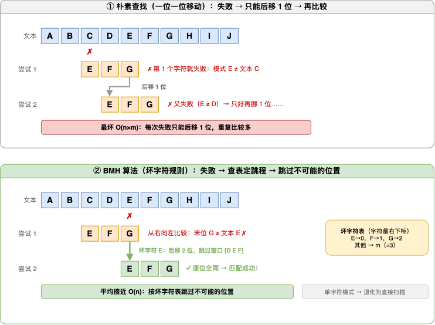

---
group:
  title: 【03】字符串介绍
  order: 3
order: 12
title: in 与 not in 运算符
nav:
  title: Python基础
  order: 1
---

# in 与 not in 运算符

## 1. 介绍

### 1.1 知识点定义

`in` 与 `not in` 是 Python 的二元运算符，标准写法是 `子串 in 字符串` 与 `子串 not in 字符串`：前者判断子串**是否存在**，后者判断子串**是否不存在**，返回值都是布尔值。

| 运算符 | 语法 | 语义 | 返回 |
|--------|------|------|------|
| `in` | `sub in s` | 子串 `sub` 存在于字符串 `s` 中吗 | `True` / `False` |
| `not in` | `sub not in s` | 子串 `sub` 不存在于字符串 `s` 中吗 | `True` / `False` |

它们与 `+`、`==` 一样是**运算符级别**的语法，不是函数调用——这也是它们表达力强、读起来像自然语言的原因。

它们解决的核心问题是：**"这段文字里有没有某个子串"**——敏感词检查、非法字符校验、配置键是否存在，凡是"只问有没有、不问在哪里"的判断都归它们管辖。

与临近工具的关系先建立一个大图景：

- `in` / `not in`——判断"有没有"，返回布尔值，不给位置
- `find` / `rfind`——给出位置索引，需要"在哪里"时用
- `count`——统计次数，需要"有几个"时用
- 三者中，判断存在性时 `in` 语义最直白：返回值**就是**答案本身

### 1.2 最简示例

先用最简单的代码直观感受这两个运算符：

```python
text = "Hello, Python World"

print(f"'Python' in text: {'Python' in text}")
print(f"'Java' in text: {'Java' in text}")
print(f"'Java' not in text: {'Java' not in text}")
```

运行结果：

```text
'Python' in text: True
'Java' in text: False
'Java' not in text: True
```

读法完全对应中文语感：**"Python" 在不在 text 里？在**；**"Java" 在不在？不在**。`not in` 是 `in` 的镜像——同一个判断的否定语气版本，专门用来表达"不存在才正常"的校验语义。

拿到结果之后，条件语句里直接用：

```python
comment = "这个教程真不错"

if "垃圾" in comment:
    print("命中敏感词，拦截")
else:
    print("内容正常，放行")
```

运行结果：

```text
内容正常，放行
```

返回值是布尔值，可以直接放进 `if`、`while`、推导式、`any()` / `all()` 的条件里，不需要任何"翻译"——这是 `in` 相比"先取位置再判断"这类绕路写法的最大优势。

## 2. 核心内容

### 2.1 in 运算符：基本用法

`in` 逐字符比对文本，子串可以在任意位置出现：

```python
text = "Hello, Python World"

print(f"'Python' in text: {'Python' in text}")
print(f"'Java' in text: {'Java' in text}")
print(f"'o' in text: {'o' in text}")
```

运行结果：

```text
'Python' in text: True
'Java' in text: False
'o' in text: True
```

| 写法 | 读法 | 返回 |
|------|------|------|
| `"Python" in text` | "Python" 存在于 `text` 中吗 | `True` |
| `"Java" in text` | "Java" 存在于 `text` 中吗 | `False` |
| `"o" in text` | 字符 "o" 存在于 `text` 中吗 | `True` |

`in` 的左右操作数可以自由替换成任何字符串表达式：

```python
keyword = "error"
log_line = "[2026-10-13 08:30:12] ERROR: timeout"

print(keyword in log_line)            # 变量 in 变量
print("error" in log_line.lower())    # 字面量 in 表达式结果
```

运行结果：

```text
False
True
```

第一个判断是 `False`：日志里是**全大写**的 `ERROR`，而关键词是小写 `error`——大小写不同的字符是不同码点，`in` 严格区分它们（这正是 2.4 节的主题）。第二个判断先把日志**整体转小写**再比较，`ERROR` 变成 `error`，匹配成功。两个结果对照着看，"为什么需要统一大小写"就一目了然。

**关键点说明**：

- 子串可以是单字符、多字符、甚至整个字符串，长度没有限制
- 位置不限：开头、中间、结尾出现都算"存在"
- 大小写敏感：`"ERROR"` 与 `"error"` 是两个不同的码点序列（2.4 节展开）

### 2.2 子串必须是"连续片段"

最容易误解的一点：**`in` 判断的是"连续出现的一段文字"，而不是"这些字符是否都存在"**。字符再多、再全，只要不连成整段、顺序对不上，结果就是 `False`：

```python
s = "hello"

print(f"'ell' in 'hello': {'ell' in s}")     # 连续片段
print(f"'hlo' in 'hello': {'hlo' in s}")     # 字符都在，但不连续
print(f"'hello' in 'hello': {'hello' in s}") # 原串自身
```

运行结果：

```text
'ell' in 'hello': True
'hlo' in 'hello': False
'hello' in 'hello': True
```

三行结果的分野：

- `"ell"` 在 `"hello"` 里作为**紧挨着的 3 个字符**出现（h-**e-l-l**-o），成立
- `"hlo"` 的 h、l、o 确实都在字符串里，但它们**不挨着**，中间被别的字符隔开、顺序也对不上，不成立
- 整串等于自身，当然成立——`in` 从不要求子串"比原串短"

用一张图直观看差异：

```text
原串:   h  e  l  l  o
             └──┘
        l 后面紧跟着 l —— "ell" 是连续切片，in 判断 True

原串:   h  e  l  l  o
        ↑        ↑  ↑
        h      l    o —— 字符都存在，但位置断断续续，连不成 h-l-o
```

一个真实业务场景更能说明这种严格性——从系统日志里判断任务执行到了哪个阶段：

```python
log = "订单数据导入成功"

print(f"出现了'数据导入': {'数据导入' in log}")
print(f"出现了'订单数据': {'订单数据' in log}")
print(f"出现了'导，成功': {'导，成功' in log}")
print(f"成功后就出现'成功导入': {'成功导入' in log}")
```

运行结果：

```text
出现了'数据导入': True
出现了'订单数据': True
出现了'导，成功': False
成功后就出现'成功导入': False
```

日志里明明有"数据"也有"导入"，可 `"数据导入"` 判断成立的前提是**这四个字以完全相同的顺序紧挨着出现**——顺序颠倒的自然就 False。同理，"导"和"成功"都在，中间插入一个逗号（或任何字符），立即不成立。**把 `in` 理解成"字符都在"是新手期最常见的认知错误**，记住它的本质：**在原串中找一段与子串一字不差的连续切片**。

**关键点说明**：

- "字符都在"的正确工具是 `all(ch in s for ch in chars)`——每个字符单独判断一次存在性（3.5 节的错误模式一专门对比）
- 连续片段不限于单词级别：任意长度、任意位置的切片都行
- `in` 从不做任何模糊匹配或重新排列——它是严格的字面比对

### 2.3 边界行为：多处出现、空字符串与超长子串

`in` 对子串的长度没有任何限制，从 1 个字符到整个字符串都可以；原串中出现**多处**时，`in` 也只回答"有没有"，不关心"有几个、在哪"：

```python
s = "mississippi"

print(f"'iss' in s: {'iss' in s}")   # 出现了 2 次
print(f"'ss' in s: {'ss' in s}")     # 出现了 2 次
print(f"'sis' in s: {'sis' in s}")   # 跨位的组合也是连续切片
```

运行结果：

```text
'iss' in s: True
'ss' in s: True
'sis' in s: True
```

注意一个细节差异："mississippi" 里 `"iss"` 整体出现了 2 次，`"ss"` 也出现了 2 次，`"sis"` 则是横跨两个位置的连续 3 字符组合——**只要从头到尾扫描时能找到任意一处完整匹配，`in` 就返回 `True`，出现次数与位置一概不管**。顺带一提，子串比原串还长时（比如 `"abcdef" in "abc"`）结果自然是 `False`，`in` 不会报错，只是如实告知"装不下、没找到"。

最反直觉的边界是**空字符串**：

```python
print(f"'' in 'Hello': {'' in 'Hello'}")
print(f"'' in '': {'' in ''}")
print(f"'x' in '': {'x' in ''}")
```

运行结果：

```text
'' in 'Hello': True
'' in '': True
'x' in '': False
```

**空串是一切字符串（包括空串自身）的子串**，所以前两个结果是 `True`；反过来，**任何非空内容都不可能在空串里**，第三个是 `False`。把边界行为汇总成表：

| 判断 | 结果 | 说明 |
|------|------|------|
| `"" in "Hello"` | `True` | 空串是任何字符串的子串 |
| `"" in ""` | `True` | 空串也是自身的子串 |
| `"x" in ""` | `False` | 非空内容不可能出现在空串里 |
| `"abcdef" in "abc"` | `False` | 子串比原串长，必然不存在 |

这些边界虽然看着"刁钻"，但很少有意去用；真正需要记住的是它们的**推论**——`""` 永远不会让 `in` 判断失败，所以**不要用 `in` 来判断"字符串是否为空"**（那是 `if not s` 的职责，空串是假值），用错工具会得到永远为 True 的恒真条件，这类 bug 在代码评审里一眼就会被揪出来。

### 2.4 大小写敏感与全半角变体

`in` 的每一次匹配都是**逐字符比较 Unicode 码点**，而大写字母与小写字母是**不同的码点**——所以 `in` 天生大小写敏感，不打招呼、不自动转换：

```python
text = "Hello, Python World"
lower_text = "hello, python world"

print(f"'python' in text: {'python' in text}")
print(f"'python' in lower_text: {'python' in lower_text}")
```

运行结果：

```text
'python' in text: False
'python' in lower_text: True
```

明明白白写着 `Python`，但用小写 `python` 去找就是 `False`。若业务语义是"忽略大小写的包含判断"，**正解是把两边的字符统一成同一种形态后再比较**（比如都转成小写再 `in`）——转换发生在匹配之前，`in` 本身不掺和任何模糊逻辑。

比大小写更隐蔽的是**全角与半角变体**。全角字母、全角感叹号与它们的半角形态看起来像"同一个字符的两种字体"，在码点世界里却是毫不相干的两个字符：

```python
print(f"'ＰＹＴＨＯＮ' in 'PYTHON': {'ＰＹＴＨＯＮ' in 'PYTHON'}")
print(f"全角 Ｐ 的码点: {hex(ord('Ｐ'))}, 半角 P 的码点: {hex(ord('P'))}")
```

运行结果：

```text
'ＰＹＴＨＯＮ' in 'PYTHON': False
全角 Ｐ 的码点: 0xff30, 半角 P 的码点: 0x50
```

全角 `Ｐ` 的码点是 `0xff30`，半角 `P` 的码点是 `0x50`，数字差了十万八千里，自然匹配不上。日常中文输入法里，感叹号、空格、标点都会随中英状态在半角/全角间切换，稍不留神就埋进数据里：

```python
ha_half = "太好了!"     # 结尾是半角感叹号
ha_full = "太好了！"    # 结尾是全角感叹号

print(f"'!' in '太好了!': {'!' in ha_half}")
print(f"'!' in '太好了！': {'!' in ha_full}")
print(f"'！' in '太好了!': {'！' in ha_half}")
print(f"'！' in '太好了！': {'！' in ha_full}")
```

运行结果：

```text
'!' in '太好了!': True
'!' in '太好了！': False
'！' in '太好了!': False
'！' in '太好了！': True
```

两个感叹号在屏幕上几乎看不出差别，`in` 却给出了截然相反的判定——**视觉相似 ≠ 码点相同**。这给"用黑名单过滤字符"提了个醒：用户输入全角噪声字符时，只配了半角形态的黑名单拦不住它（对策在 2.8 节展开）。遇到"数据明明看着一样、程序就是判 False"的怪事，第一反应应该是**变体字符**：大小写、全半角、组合形态，逐层排查。

### 2.5 惯用组合：any、推导式与哨兵检查

`in` 返回布尔值，天生为条件语句与推导式而生。三种最常用的组合模式，覆盖了日常九成的场景。

**模式一：`any()` 扫描一组候选关键词**。"只要命中任意一个就成立"的需求，用 `any()` + 生成器表达最自然：

```python
sensitive_words = ["广告", "刷单", "诈骗"]
comments = ["这个课太值了", "点我领广告红包", "质量不错"]

for comment in comments:
    if any(word in comment for word in sensitive_words):
        print(f"拦截: {comment}")
    else:
        print(f"放行: {comment}")
```

运行结果：

```text
放行: 这个课太值了
拦截: 点我领广告红包
放行: 质量不错
```

`any(word in comment for word in sensitive_words)` 读作"词表里**任意一个**词出现在评论中就为真"。它还自带**短路**特性：从第一个词开始依次检查，一旦命中立即返回 `True`、余下的词不再比较——词表越靠前放高频词，整体越快（3.6 节性能要点展开）。

**模式二：推导式做批量过滤**。`in` 放进推导式的 `if` 条件里，一组数据瞬间筛完：

```python
emails = ["a@qq.com", "b@163.com", "bad_user", "c@gmail.com"]

valid_emails = [e for e in emails if "@" in e]
print(valid_emails)
```

运行结果：

```text
['a@qq.com', 'b@163.com', 'c@gmail.com']
```

一行筛出所有"包含 @"的邮箱，`bad_user` 被滤掉、其余保留。数据集变大后，这行代码依然是纯文本扫描，量级完全可控。

**模式三：循环里做"哨兵"检查**。流式处理日志、消息批次时，`in` 常驻在循环体内充当告警哨兵：

```python
chunks = [
    "2026-10-13 INFO 数据导入完成",
    "2026-10-13 ERROR 连接超时",
]

for i, chunk in enumerate(chunks, 1):
    if "ERROR" in chunk:
        print(f"第 {i} 段日志发现错误关键词，触发告警")
    else:
        print(f"第 {i} 段日志正常")
```

运行结果：

```text
第 1 段日志正常
第 2 段日志发现错误关键词，触发告警
```

每读到一段就问一句"这段里有没有 `ERROR`"，有则立刻告警。**"高性能的哨兵检查 = 单一关键词 + 数据一段段过"**，关键词越短、判断越集中，扫描成本越低（背后原因在第 4 章展开）。三种模式合起来看：`in` 的单次判断简单，但把它放进 `any()`、推导式、循环里组合使用，才是它在真实工程里的完整形态。

### 2.6 not in：语义与三种写法

`not in` 是 `in` 的镜像运算符：**子串不存在返回 `True`，存在返回 `False`**。它把"检查违规内容"这类以"否定"为语义的判断写成了正面语气，是所有校验器里出现频率最高的写法之一。

同一个"不存在"的判断，Python 里有三种等价写法：

```python
text = "Hello, Python World"

# 三个写法判断的都是同一件事："Java" 不存在于 text 里
print(f"写法一 'Java' not in text: {'Java' not in text}")
print(f"写法二 not ('Java' in text): {not ('Java' in text)}")
print(f"写法三 not 'Java' in text: {not 'Java' in text}")
```

运行结果：

```text
写法一 'Java' not in text: True
写法二 not ('Java' in text): True
写法三 not 'Java' in text: True
```

再对实际存在的词做一次，确认三种写法的行为始终一致：

```python
text = "Hello, Python World"

print(f"写法一 'Python' not in text: {'Python' not in text}")
print(f"写法二 not ('Python' in text): {not ('Python' in text)}")
print(f"写法三 not 'Python' in text: {not 'Python' in text}")
```

运行结果：

```text
写法一 'Python' not in text: False
写法二 not ('Python' in text): False
写法三 not 'Python' in text: False
```

三次结果完全一致，证明三种写法语义等价。但三者的可读性完全不同：

| 写法 | 解析逻辑 | 评价 |
|------|----------|------|
| `'Java' not in text` | `not in` 整体是一个运算符 | **推荐**，一步到位语义清晰 |
| `not ('Java' in text)` | 先算 `in` 再对结果取反 | 可用，但绕了一步 |
| `not 'Java' in text` | `in` 优先级更高，等效于 `not ('Java' in text)` | 能跑但读起来歧义大，**不推荐** |

- **写法一**是官方推荐：`not in` 是一个完整的运算符，中间不加括号；左操作数、`not in`、右操作数，读起来就是"Java 不在 text 里"
- **写法二**逻辑正确、结果正确，但"先做一次正判断再取反"多了一层心智转弯；读者要在脑中把 `in` 的 True/False 颠倒一次才能理解你的意图
- **写法三**依赖运算符优先级的隐式规则才成立，**人扫代码时极易把它错读成别的组合**，代码评审中最容易被 challenge

所以结论明确：否定语义一律写 `x not in s`，既不需要括号、也不需要前置 `not`。

### 2.7 排除非法字符：黑名单校验

用户名里不允许出现特殊符号？黑名单定义一串"非法字符"，逐一检查它们是否出现在输入里，出现任何一个就拒绝：

```python
disallowed_chars = "!@#$%^&* "

for name in ["top admin", "alen!2026", "alen2026"]:
    hit = [ch for ch in disallowed_chars if ch in name]
    if hit:
        print(f"不通过，'{name}' 命中非法字符: {hit}")
    else:
        print(f"'{name}' 通过")
```

运行结果：

```text
不通过，'top admin' 命中非法字符: [' ']
不通过，'alen!2026' 命中非法字符: ['!']
'alen2026' 通过
```

这个模板的三个要点：

- **用 `in` 逐个筛黑名单**：`ch in name` 问"这个非法字符在不在用户名里"，推导式把命中的全部捞出来，`hit` 列表非空即违规
- **报错信息附带命中详情**：把 `hit` 打出来，用户一眼看到"原来空格也算非法字符"，比干巴巴一句"不合法"体验好得多
- **黑名单的天然短板**：它只能拦"你想得到的坏字符"，想不到的变体全都漏网——这正是下一小节的主题

单字符的快速排除则更简洁，一行就够：

```python
filename = "report_v2.txt"

print(f"'/' not in filename: {'/' not in filename}")
```

运行结果：

```text
'/' not in filename: True
```

文件名里禁止出现路径分隔符，`'/' not in filename` 一个判断就完成了这条规则。

### 2.8 变体字符：全角空格绕过黑名单

`in` / `not in` 严格按码点匹配，这让黑名单出现了一个真实存在的漏洞——**变体字符**。中文输入法在半角/全角之间切换时，敲出来的空格可能是全角的，而两个空格是**完全不同的两个字符**：

```python
disallowed = "@#$% &"      # 黑名单里写的是半角空格

print(f"半角空格在黑名单: {' ' in disallowed}")
print(f"全角空格在黑名单: {'　' in disallowed}")
```

运行结果：

```text
半角空格在黑名单: True
全角空格在黑名单: False
```

黑名单检查半角空格拦得干干净净，但用户输入一个全角空格，`'　' in disallowed` 是 `False`——**黑名单查无此人，校验放行**。同样的剧情还会出现在全角感叹号 vs 半角感叹号、全角冒号 vs 半角冒号、大小写字母之间：黑名单若只配了一种形态，另一个形态就是畅通无阻的后门。

应对策略有两条，按优先级排：

- **优先用白名单取代黑名单**：白名单写"只允许哪些字符"，其它一切（包括你没想到的所有变体）天然全部被拒，3.1 节给出完整的对照实现
- **黑名单必须配全所有变体**：逐个补齐全角/半角、大小写形态。想象空间有限的场景（比如只拦中文脏话的敏感词库），黑名单自有其灵活性，但**每一次"看起来该拦却没拦"的事故，都要回头检查是不是漏了变体**

**安全校验的一条铁律**：黑名单在对抗性场景（用户刻意绕过）下千疮百孔，白名单才是稳妥的默认选择。判断标准很朴素——这份校验是在"防手滑"还是在"防对抗"？防手滑用黑名单省事；防对抗必须白名单。

### 2.9 只问"有没有"：in 是最直白的存在性判断

把日常的文本判断需求拆开看，本质上是三类问题：

```text
存在性 —— "里面有没有 Python？"          → 一个 True / False 就能回答
定位   —— "Python 出现在第几个字符？"     → 需要一个位置数字
计数   —— "Python 一共出现了几次？"       → 需要一个次数
```

你也会见到另一路写法——先用查找类工具取位置，再借位置间接判断存在性，比如 `pos = text.find("Python")` 拿到出现位置后再检查它是否有效。这相当于**先回答"在哪里"，再绕回来回答"有没有"**；查找与计数类工具属于独立的主题。当需求只有"有没有"时，`in` 一步到位：

| 目标 | 绕路写法 | 直白写法 |
|------|----------|----------|
| 判断 "Python" 是否在 text 里 | 先取出现位置 `pos = text.find("Python")`，再检查位置是否有效 | `"Python" in text` |

两种写法结果一致，但语义差了一层：`in` 的返回值**就是**存在性本身，读代码的人所见即所得；位置判断则要求读者脑内多翻译一步"位置有效 ⇔ 存在"。写业务校验时多用一步直接的工具，代码的可读性就来自这些细节的选择：

```text
你的需求是什么？
│
├── 只问"有没有某段文字"          →  直接 x in s / x not in s
│      例：敏感词检查、禁用字符校验、配置键是否存在
│
└── 还需要"在哪里 / 有几个"等信息  →  查找与计数类工具的主题
```

**关键点说明**：这条分界线也是全篇的使用原则——`in` / `not in` 只负责布尔答案。一旦发现自己在 `if` 里比较 `find` 的返回值，就该意识到写绕了：那个分支要的其实只是 `in`。

## 3. 应用场景实战

单独的运算符只有组合进真实业务才有生命力。下面几个高频场景，分别代表"输入合法性校验"、"内容合规检查"、"配置完整性检查"三大流派，`in` / `not in` 在其中承担的都是"存在性"这一职：

| 场景 | in / not in 承担 |
|------|------------------|
| 用户名注册校验 | 不含非法字符、不含保留字 |
| 评论敏感词检查 | 命中任何一个敏感词就拦截 |
| 配置项完整性检查 | 缺哪个键一览无余，缺失键用默认值兜底 |

### 3.1 用户名注册校验

用户名往往要同时满足多条规则：长度适中（数量关由 `len()` 把守）、不含特殊符号、不占用系统保留字。后两条存在性规则正是 `in` 的经典战场：

```python
def validate_username(name):
    """校验用户名：长度 3~12、不含非法字符、不含保留字"""
    errors = []

    # 规则一：长度区间（数量关，len 把守）
    if not (3 <= len(name) <= 12):
        errors.append(f"长度需在 3~12 之间（当前 {len(name)}）")

    # 规则二：不允许出现的字符（in 登场）
    disallowed = "!@#$%^&* "
    hit = [ch for ch in disallowed if ch in name]
    if hit:
        errors.append(f"包含非法字符: {hit}")

    # 规则三：不允许出现的词（保留字必须 not in 用户名）
    reserved = ["admin", "root", "system"]
    for word in reserved:
        if word in name:
            errors.append(f"不能包含保留字: {word}")

    return errors


for username in ["Alen", "cat", "top admin", "张三", "ok_user_2026"]:
    errors = validate_username(username)
    if not errors:
        print(f"通过: {username!r}（len={len(username)}）")
    else:
        print(f"不通过: {username!r}（len={len(username)}）")
        for err in errors:
            print(f"    -> {err}")
```

运行结果：

```text
通过: 'Alen'（len=4）
通过: 'cat'（len=3）
不通过: 'top admin'（len=9）
    -> 包含非法字符: [' ']
    -> 不能包含保留字: admin
不通过: '张三'（len=2）
    -> 长度需在 3~12 之间（当前 2）
通过: 'ok_user_2026'（len=12）
```

逐条对照规则与结果，可以看到存在性判断如何分工：

- **规则二是字符级黑名单**：黑名单字符逐个 `ch in name` 检查，`'top admin'` 里的空格被当场抓获，还把命中的字符一起报出来
- **规则三是词级黑名单**：保留字 `"admin"` 在用户名里出现即拒绝——"top admin" 同时违反规则二和规则三，两行错误信息**同时列出**，这归功于 errors 列表的聚合设计：每条规则独立检查、独立报告，不因前一条违规就提前退出
- **报错体验**：统一的 "不通过 + 逐条原因" 输出，比一句干巴巴的 False 更能指引用户

再把它与白名单写法对照——白名单思路是反过来数"允许什么"，其余一律拒绝：

```python
allowed = "abcdefghijklmnopqrstuvwxyzABCDEFGHIJKLMNOPQRSTUVWXYZ0123456789_"

for name in ["student_01", "张三"]:
    ok = all(ch in allowed for ch in name)
    print(f"{name!r} 白名单校验: {'通过' if ok else '不通过'}")
```

运行结果：

```text
'student_01' 白名单校验: 通过
'张三' 白名单校验: 不通过
```

`all(ch in allowed for ch in name)` 逐个检查用户名的每个字符**都必须在允许集合里**，任何一个不认识就整体拒绝。效果立竿见影：`'张三'` 的汉字不在白名单里直接出局——这正是黑名单永远做不到的"漏网之鱼一律拦截"（2.8 节的全角空格在白名单下同样无处遁形）。白名单也更精简：不需要枚举"所有坏字符"，只需要维护"好字符"这一张稳定的清单。

### 3.2 评论区敏感词检查

评论、弹幕、商品描述等 UGC 内容上线前要过一道敏感词扫描。词表驱动 + `in` 逐词命中，是这类检查的标准形态：

```python
banned_words = ["垃圾", "骗人", "代刷"]

def check_comment(comment):
    if not comment:                # 空内容直接拒绝（空字符串是假值）
        return "内容为空，拒绝发布"
    hit = [w for w in banned_words if w in comment]
    if hit:
        return f"包含敏感词: {', '.join(hit)}，转入人工审核"
    return "内容正常，直接发布"


for text in ["这个教程真不错", "垃圾内容，纯属骗人", ""]:
    print(f"评论 {text!r} -> {check_comment(text)}")
```

运行结果：

```text
评论 '这个教程真不错' -> 内容正常，直接发布
评论 '垃圾内容，纯属骗人' -> 包含敏感词: 垃圾, 骗人，转入人工审核
评论 '' -> 内容为空，拒绝发布
```

结构逐层拆解：

- **词表与逻辑分离**：敏感词装在 `banned_words` 列表里，运营侧随时增删，检查逻辑一行不用改
- **命中即拦截**：`[w for w in banned_words if w in comment]` 把命中的敏感词**全部**捞出来而不是找到一个就停，审核员看到 "垃圾, 骗人" 两个词同时报出，处理时心里有完整的底
- **空内容直接拒绝**：`if not comment` 利用了"空字符串是假值"这一事实——空串判断交给布尔语义，不绕道存在性检查
- **分级处理**：正常内容直接放行、命中敏感词转人工——两个字表命中的严重程度不同，分流处理而不是一刀切

若业务要求忽略大小写地匹配英文敏感词，还是 2.4 节的正解：检查前先把评论整体转小写、词表也统一小写，两边形态一致后 `in` 自然命中。

### 3.3 配置项完整性检查与默认值兜底

配置文件少写一个键，程序往往要跑到用它的那一行才崩溃。启动时用 `not in` 做一次完整性检查，缺失键一目了然，还能顺手做默认值兜底：

```python
required = ["host", "port", "username", "timeout"]
config = {"host": "localhost", "port": 3306, "username": "root"}

# 逐个检查必须存在的键，缺失的一网打尽
missing = [k for k in required if k not in config]
print(f"缺少配置项: {missing}")

# 缺失的键不必崩溃，可以用默认值兜底
timeout = config["timeout"] if "timeout" in config else 30
print(f"timeout = {timeout}（默认值兜底）")
print(f"port = {config['port']}（配置文件里已有）")
```

运行结果：

```text
缺少配置项: ['timeout']
timeout = 30（默认值兜底）
port = 3306（配置文件里已有）
```

两行输出对应两种策略：

- **完整性检查**：推导式 `[k for k in required if k not in config]` 以"必须存在的键"为基准逐个 `not in` 探查，`'timeout'` 缺失被单独列出；启动日志里这样一行信息，比运行中途的 KeyError 好排查太多
- **默认值兜底**：`config["timeout"] if "timeout" in config else 30` 在"键存在"与"键缺失"之间平滑切换——存在就尊重配置，缺失就用兜底值继续跑，服务韧性 +1

顺带呼应一个知识点：`in` / `not in` 并非字符串专属——用在字典上判断的是"键是否存在"。`"timeout" in config` 读作 "timeout 是不是 config 的键"，这正是配置检查的语义；字符串章节里讲的码点匹配规则在这里不参与，因为匹配对象换成了字典的键。工具相同、场景换用，`in` 的适应力可见一斑。

### 3.4 综合演练：一篇文章发布前的三道关

把存在性判断串成完整的流程。需求是"技术博客发布前做最后的合规检查"，规则有三道（长度关由 `len()` 把守，后两关才是 `in` / `not in` 的主场）：

```text
第一关（长度关）  →  标题必须 6~30 字     → 数量判断
第二关（必含关）  →  必须包含核心关键词    → not in 找出缺失
第三关（禁含关）  →  不能出现营销违禁词    → in 一票否决
```

完整实现：

```python
core_keywords = ["Python", "实战"]
banned_phrases = ["独家", "第一", "必看"]

def check_title(t):
    issues = []

    # 第一关：长度（数量关）
    if not (6 <= len(t) <= 30):
        issues.append(f"标题长度需在 6~30 之间（当前 {len(t)}）")

    # 第二关：必含关键词（not in 找缺失）
    missing = [kw for kw in core_keywords if kw not in t]
    if missing:
        issues.append(f"缺少核心关键词: {missing}")

    # 第三关：禁含违禁词（in 抓现行）
    hit = [p for p in banned_phrases if p in t]
    if hit:
        issues.append(f"包含营销违禁词: {hit}")

    return issues


good_title = "Python 并发编程实战指南"
issues = check_title(good_title)
if not issues:
    print(f"可发布（len={len(good_title)}）")
else:
    print("需修改:")
    for i in issues:
        print(f"    -> {i}")

bad_title = "必看！独家 Python 宝典"
print(f"再试一个会翻车的标题（len={len(bad_title)}）:")
issues = check_title(bad_title)
if not issues:
    print(f"可发布（len={len(bad_title)}）")
else:
    print("需修改:")
    for i in issues:
        print(f"    -> {i}")
```

运行结果：

```text
可发布（len=15）
再试一个会翻车的标题（len=15）:
需修改:
    -> 缺少核心关键词: ['实战']
    -> 包含营销违禁词: ['独家', '必看']
```

仔细看这两个标题的命运分野，正好把存在性判断的用法收拢到一起：

- **`"Python 并发编程实战指南"`（len=15）**：长度关通过（6 ≤ 15 ≤ 30）；"Python" 与 "实战" 两个核心关键词都在场，`missing` 为空；"独家"、"第一"、"必看" 一个都没碰，`hit` 为空——三道关全过，可发布
- **`"必看！独家 Python 宝典"`（len=15）**：同样 15 个字符，长度关也过了——但第二关现出原形："实战" 缺位，`missing` 抓到缺失；第三关同时命中 "独家" 与 "必看" 两个违禁词，直接拦下

两个标题的 `len()` **一模一样**，结局却一个放行一个拦截——这组对照说明：**长度只回答"够不够"，`in` / `not in` 才回答"合不合规"**；数量合格不等于内容合格，两类判断谁也替代不了谁。代码实现上再注意两个细节：三道关各自独立检查、错误**累加**报告（不搞一票否决的提前 return），以及两个词表独立外置——运营改词表不必动逻辑，这份校验器就有了持续演化的骨架。

### 3.5 常见错误模式与修正

以下错误模式覆盖了初学者与有经验开发者**共同的**踩坑点，每一种都值得在代码评审清单里占一行。

**错误模式一：把 `in` 当"字符都在"来用**

想要判断"几个标志性字符是否都出现过"，直接把字符拼成一串丢给 `in`——错。`in` 找的是**连续切片**：

```python
banner = "hello, world"

print(f"'hlo' in banner: {'hlo' in banner}")
print(f"逐个字符都在吗: {all(ch in banner for ch in 'hlo')}")
```

运行结果：

```text
'hlo' in banner: False
逐个字符都在吗: True
```

`"hlo"` 不是 `"hello, world"` 的连续片段，于是 `in` 返回 False；但把每个字符**单独**与字符串做 `in` 判断再 `all()` 聚合，答案就是 True。**两种意图各有各的写法**：想要"连成一体的段落"用 `in` 直接判；想要"这些字符都得出现"用 `all(ch in s for ch in chars)`。意图与工具对上号，才不会写出"测试通过、逻辑全错"的代码。

**错误模式二：用"包含"冒充"以什么结尾"**

判断文件是否以 `.py` 结尾时，写成 `".py" in filename`——看起来工作了，实际上埋着误判：

```python
filename = "backup.py.bak"

print(f"'.py' in filename: {'.py' in filename}")

expected_suffix = ".py"
actual_tail = filename[-len(expected_suffix):]   # 按预期后缀的长度切出真正的尾部
print(f"真正的尾部: {actual_tail!r}")
print(f"以 .py 结尾吗: {actual_tail == expected_suffix}")
```

运行结果：

```text
'.py' in filename: True
真正的尾部: 'bak'
以 .py 结尾吗: False
```

`backup.py.bak` 中间含有 `.py`，`in` 照样返回 True；而按后缀长度切出真正的尾部（`filename[-len(".py"):]`，即最后 3 个字符）对比，才暴露它实际以 `.bak` 结尾。**`in` 只回答"某处出现过"，不回答"出现在哪、是不是在结尾"**——需要结构化位置语义（开头、结尾）时，正确做法是按预期模式的长度切出对应区段再做相等比较。判空另说：那句总结在这里同样成立——**"出现过"和"长在这里"是两回事**。

**错误模式三：多条独立规则揉进一个子串判断**

密码要求"包含字母**且**包含数字"，有人想找一个"包含字母数字"的子串判断来一次通过——这样的连续片段在密码里根本不存在，判断必然失败。正确做法是**把每条规则拆成独立的存在性检查再组合**：

```python
letters = "abcdefghijklmnopqrstuvwxyz"
digits = "0123456789"
password = "abc123456"

has_letter = any(ch in letters for ch in password)
has_digit = any(ch in digits for ch in password)

print(f"包含字母: {has_letter}")
print(f"包含数字: {has_digit}")
```

运行结果：

```text
包含字母: True
包含数字: True
```

`any(ch in letters for ch in password)` 问"密码里**有没有**字符出现在字母表里"，`any(ch in digits for ...)` 单独回答数字位——两条规则两条检查，各自独立、各自可扩展（以后加"必须包含特殊字符"就再加一行 `any(...)`）。**规则的边界感就是代码的扩展性**：把"字母、数字两类要求"锁定在两个独立表达式里，将来规则从 2 条涨到 5 条时依然清晰；而"希望能一个子串判断搞定"的执念，才是这类校验写歪的根源。此外还有一个实现细节：字母表、数字表单独定义为常量，肉眼可审计、可按业务调整（比如要求"必须有大小写"，把字母表拆成两张即可）。

三个错误模式合起来，是一句共同的心法：**`in` 只回答"某段连续文字出现没出现"**——想问别的（字符都在、长在结尾、多规则同时满足），先把需求翻译成正确的判断结构，再选对应用工具。

### 3.6 性能要点

`in` 平均线性且常数极小。三个要点用实测数据说话（测试机数字会浮动，关注量级关系而非具体数值）。

**要点一：存在性判断交给内置 `in`，绝不手写扫描循环**

同一任务（在一千万字符里找子串）两种写法的对决：

```python
import timeit

big = "a" * 10_000_000 + "needle"

def builtin_in():
    return "needle" in big

def manual_scan():
    for i in range(len(big) - 5):
        if big[i:i+6] == "needle":
            return True
    return False

t_builtin = timeit.timeit(builtin_in, number=20)
t_manual = timeit.timeit(manual_scan, number=20)
print(f"内置 in x 20 次:      {t_builtin:.4f} 秒")
print(f"手写逐位扫描 x 20 次: {t_manual:.4f} 秒")
```

运行结果：

```text
内置 in x 20 次:      0.0156 秒
手写逐位扫描 x 20 次: 10.8223 秒
```

同样是 20 次查找，内置 `in` 快了约**三个数量级**。差距来自两层：算法层，内置实现在 C 层使用跳跃式扫描（失配时一次跳过多个不可能的位置，第 4 章展开）；执行层，手写版每个位置都要做一次切片加一次比较，纯 Python 解释执行，每次循环都是一笔解释器开销。**只要写得出 `"x" in s`，就不要写任何形式的"逐位查找"循环**——这不是风格的偏好，是数百倍的性能之差。

**要点二：同一文本多次判断时，转换动作放循环外**

忽略大小写的多词表检查，两种写法只差 `lower()` 的位置：

```python
import timeit

text = "Order Import ERROR: Connection Timeout" * 10000   # 约 38 万字符
keywords = ["warning", "critical", "fatal"]               # 都不在文本里，循环跑满 3 轮

def lowercase_inside_loop():
    for kw in keywords:
        if kw in text.lower():    # 每轮循环都转换一次
            return True
    return False

def lowercase_once():
    lowered = text.lower()         # 只转换一次
    for kw in keywords:
        if kw in lowered:
            return True
    return False

t_inside = timeit.timeit(lowercase_inside_loop, number=100)
t_once = timeit.timeit(lowercase_once, number=100)
print(f"循环内每次都转换: {t_inside:.4f} 秒")
print(f"循环外转换一次:   {t_once:.4f} 秒")
```

运行结果：

```text
循环内每次都转换: 0.0946 秒
循环外转换一次:   0.0656 秒
```

`text.lower()` 是**全量转换**：生成一整个新字符串，成本随文本长度线性增长。循环 3 个关键词就转换 3 次，无形中把转换成本放大了 3 倍；把它提到循环外只做一次，后续判断共享同一份结果。词表越长、文本越大，这个差距越明显。**规律总结：凡是"对同一文本的重复预处理"（大小写转换、形态归一），一律提到判断循环之外**——转换是一次性成本，不要让它跟着循环走。

**要点三：词表检查利用 `any` / `all` 的短路特性**

`any(w in s for w in words)` 从词表第一项开始判断，一旦命中立即返回 `True`，剩余的词全部跳过；`all(...)` 则相反，遇到第一个不满足立即返回 `False`。两点实用推论：

- **热词放在越靠前，短路越早发生**：把统计上最常命中的词排在词表前面（比如最高频的敏感词），平均判断次数显著下降
- **长词表 + 大文本**的组合下，短路省下的是一整轮 `in` 扫描，收益直接乘上文本长度

三条合起来是一条主线：**`in` 本身足够快，性能优化的空间全在"调用位置与调用频率"上**——`in` 大胆用、转换别重复、词表讲顺序。真正的性能杀手从来不是这个运算符，而是把它放错位置的写法。

### 3.7 需求决策速查表

把前文所有结论压缩成一张速查表，遇到"这个判断该怎么写"时直接对号入座：

| 需求 | 首选写法 |
|------|----------|
| 判断某段文字是否存在 | `x in s` |
| 判断某段文字是否不存在（排除） | `x not in s` |
| 多个关键词，命中任意一个就成立 | `any(w in s for w in words)` |
| 多个关键词，必须全部存在 | `all(w in s for w in words)` |
| 每个字符都必须在允许集合（白名单） | `all(ch in allowed for ch in s)` |
| 不允许任何字符来自禁止集合（黑名单） | `any(ch in banned for ch in s)` |
| 忽略大小写的存在判断 | `x.lower() in s.lower()`（同一文本多次判断时转换只做一次） |
| 找出命中的敏感词（要列出来） | `[w for w in words if w in s]` |
| 找出缺失的配置项 | `[k for k in required if k not in config]` |

使用心法一句话：**先分清"有没有"，再分清"正着问还是反着问"**——存在写 `in`，不存在写 `not in`；最后若涉及组合（多词表、黑白名单、逐字符），套 `any` / `all` + 生成器表达式的固定骨架即可。三步走完，写出来的就是团队里最规范的那一版代码。

## 4. 原理

用法与最佳实践解决"怎么用"，本章回答"为什么"：为什么 `in` 比手写的查找快出几个数量级？为什么它天生大小写敏感？为什么空串是任何字符串的子串？三个答案分别在 CPython 的匹配引擎里、在码点比较的规则里、在"子串"的形式化定义里。

### 4.1 in 的底层：stringlib fastsearch

`in` 背后的匹配引擎是 CPython 的 stringlib fastsearch——一套源自 Boyer–Moore–Horspool 系算法的快速查找实现。它的核心思想可以概括成一句话：**匹配失败时，利用已经比对过的信息，一次跳过多个绝无可能的位置，而不是呆板地后移一格重来**。

用"文本里找子串"的过程直观感受两种思路的差别：

```text
朴素的思路：每次失败只向后挪 1 格，再从头逐字比对

  文本:  a b a b a b a b a b a b ...
  子串:  a b a b a b c
                    ↑ 在第 7 个字符失配
  挪 1 格重来 → 又要逐字比 6 次才再失败 → 大量机械重复

fastsearch 的思路：按失配时对齐的文本字符，推断一次能安全跳多远

  文本:  a b a b a b a b a b a b ...
  子串:  a b a b a b c
                    ↑ 失配 → 根据对齐位置上的文本字符，
                       直接跳到下一个可能对齐的点
                     → 跳过的位置是"子串绝不可能出现的位置"，不用再试
```



这个策略带来两个工程结论：

- **平均性能接近 O(n)**：n 是文本长度。绝大多数失配都能跳过一大段，整体扫描成本与文本长度大体线性相关——10 万字符的文本平均也就扫十几万字符的量级，而不是理论上的十亿级比较
- **最坏退化到 O(n×m)**：构造极端刁钻的文本与样本（比如 `"aaaa"` 里找 `"aab"`）时跳跃失效。但日常文本完全达不到这种对抗形态，不必担心

还有一个特例：当子串长度为 1 时，fastsearch 实际退化为对单字符的高速扫描，比多字符匹配还要快。涉及性能敏感的过滤器热点时，优先把判断样本简化（比如直接判单个字符而不是长句），收益立现。

把 3.6 的实测结论与本章原理串起来就完整了：`in` 快在**算法**（跳跃扫描，平均 O(n)），又跑在 C 层不经过 Python 解释器逐条执行指令。理解了这个"快"的来源，也就理解了为什么"不要手写查找循环"是硬规矩而不是风格建议。

### 4.2 大小写敏感的根源：比较的是码点

`in` 的匹配动作可以拆成"在某个起点上，逐字符比对码点是否相等"。大小写字符是**不同的码点**，比较结果自然不同——敏感是码点比较的直接推论：

```python
print(f"ord('P') = {ord('P')}")
print(f"ord('p') = {ord('p')}")
```

运行结果：

```text
ord('P') = 80
ord('p') = 112
```

`"Python"` 与 `"python"` 从第一个字符起就分道扬镳（80 ≠ 112），不需要再往后比。再看全角标点与半角标点这对"视觉双胞胎"：

```python
print(f"ord('，') = {ord('，')}")
print(f"ord(',') = {ord(',')}")
```

运行结果：

```text
ord('，') = 65292
ord(',') = 44
```

全角逗号与半角逗号码点相差六万多，在 `in` 眼里是两个毫不相干的字符——这就是 2.8 节里全角空格绕过黑名单的根源，也是 2.4 节里全角感叹号判定反转的根源。同一个结论适用所有"看着像"的字符：全角字母与半角字母、中文标点与英文标点、组合字符与合成字符。明白了"比的是数字"这一点，也就明白了为什么"忽略大小写必须先转换"——**转换的本质是让两边的码点变成同一个数字**；转换之后没有任何"模糊匹配"发生，依然是逐码点精确比较，只不过比较的双方已经被提前拉到了同一形态。

### 4.3 空串为何是任何字符串的子串

把"存在子串"形式化：**能不能找到一个起点 i，使得 s[i : i + len(sub)] == sub**。对空串来说，`len(sub)` 是 0，于是问题变成"s[i : i + 0] 是否等于空串"——切 0 个字符，永远等于空串：

```python
s = "abc"

print(f"s[0:0] = {s[0:0]!r}")
print(f"s[1:1] = {s[1:1]!r}")
print(f"s[2:2] = {s[2:2]!r}")
```

运行结果：

```text
s[0:0] = ''
s[1:1] = ''
s[2:2] = ''
```

无论从哪个起点出发，切出 0 个字符的结果都只能是空串——所以 `"" in s` 对任何 s 都成立（包括 `"" in ""` 自身）：

```text
形式化视角：s = "abc"，sub = ""

存在起点 i 使得 s[i : i + 0] == ""？
  i = 0:  s[0:0] == ""   成立
  i = 1:  s[1:1] == ""   成立
  i = 2:  s[2:2] == ""   成立
  三个起点全部成立 —— 子串存在，in 返回 True

反方向：s = ""，sub = "x"

存在起点 i 使得 s[i : i + 1] == "x"？
  空串没有任何起点切得出 1 个字符 —— 不存在
  子串不存在，in 返回 False
```

反方向同理清晰：空字符串的数据区是空的，**任何起点都切不出 1 个字符**，所以 `'x' in ""` 恒为 False。两个边界合起来恰好构成 2.3 节那张速查表的全部结论，而且解释了为什么它们"长得反直觉"——直觉把 `in` 想成"有没有内容重叠"，而形式化的它只是"能不能切出一段相等的切片"。

这个原理同时给出了最实用的一条工程提醒：既然 `"" in s` 永远成立，**用 `in` 判断空串必然写出恒真条件**——判空的正确工具是 `if not s`（空串是假值），这与全篇的推荐写法首尾呼应。

## 5. 总结

本文围绕 `in` 与 `not in` 运算符展开，主要介绍了以下内容：

- `in` / `not in` 是二元运算符（不是函数调用）：前者判断子串是否存在、后者判断是否不存在，返回布尔值，可直接放进 `if`、推导式、`any()` / `all()` 的条件里
- `in` 只认**连续片段**："字符都在但顺序断续"不成立；在原串中找的是一段与子串**一字不差的连续切片**
- 边界行为：多处出现只回答"有没有"不回答"有几个/在哪"；子串比原串长返回 False；空串是一切字符串的子串，非空内容不可能出现在空串里——推论是**永远不要用 `in` 判空串**（判空用 `if not s`）
- 大小写与变体敏感：`in` 逐字符比较 Unicode 码点，大小写、全角/半角都是不同码点自然判定不同；忽略大小写的正解是**两先统一形态再比较**（都转小写）
- `not in` 是一个完整的运算符：否定语义一律写 `x not in s`；`not ('x' in s)` 绕一步，`not 'x' in s` 依赖优先级且极易误读
- 黑白名单选型：黑名单防不住全角变体与漏想字符，防对抗场景用白名单（`all(ch in allowed for ch in s)`）一劳永逸；防手滑场景黑名单更轻便
- 惯用组合三模式：`any()` 扫描多关键词（自带短路）、推导式批量过滤（`if "@" in e`）、循环内哨兵检查（流式告警）
- 典型场景：用户名校验（黑名单字符 + 保留字 + 白名单对照）、敏感词检查（词表驱动 + 命中全列 + 分级处理）、配置完整性（`not in` 探缺失 + 默认值兜底）、发布前三道关（数量关与内容关各司其职）
- 四类高频错误：把 `in` 当"字符都在"（它是连续切片，"字符都在"用 `all`）、用"包含"冒充"以某结尾"（切尾部比较）、多条规则揉成一个子串判断（拆成独立检查再组合）、以及绕路写 `find` 判存在（`in` 的返回值就是存在性本身）
- 性能结论：内置 `in` 走 C 层跳跃扫描，比手写逐位循环快约三个数量级；同一文本的预处理（`lower()` 等）放循环外只做一次；词表把高频词排前面吃满 `any` / `all` 短路红利
- 底层机制：`in` 由 stringlib fastsearch 实现（跳跃扫描，平均 O(n)、最坏 O(n×m)）；大小写敏感源自码点比较（80 ≠ 112、65292 ≠ 44）；空串边界是"切 0 个字符恒成立"的形式化推论
